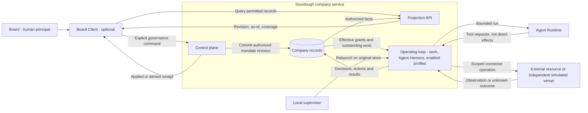

# Sourdough MVP capability map

Design draft · 2026-11-21 · Product verification is unrun. Start with the [business goal and three evidence claims](intent.md#business-goal-and-falsifiable-hypothesis); use this map for ownership and the [first integration contract](acceptance/first-shift/spec.md) for the first working demonstration.

**Start with two organizational concepts.** [Company](company/README.md) is accountable for purpose, assets, authority and continuity. [Employee](employee/README.md) accepts duties and exercises judgment. Below these, company systems keep the accountable records, and an Agent implements the employee. A business profile specializes selected operations; a client presents them.

**Choose a view before choosing a directory.** The [회사 · Agent · 퀀트 책임 계층과 업무 흐름](company-agent-quant.md) contains the full system boundaries, detailed flow diagrams and owner contracts. Role names and business-system decomposition are illustrative, not mandatory structure. The [architecture atlas](views.md) maps the same company by meaning, capabilities, authority, components, runtime behavior, information, deployment and evidence. Use the [functional map](capabilities.md) to find a business outcome across domains, or the [ownership matrix](#system-hierarchy) to find the one component allowed to write a fact.

Read the [system architecture](architecture.md), [domain glossary](glossary.md) and [design conventions](conventions.md) before opening a unit spec.

The [responsibility and unattended-operation audit](engineering/responsibility-audit.md) records the reviewed document inventory, corrected cross-owner contracts and remaining unrun evidence.

The [feature purpose, boundary and outcome inventory](engineering/feature-boundaries.md) traces every feature intent to its operating need and observable result. It links to the owning intents and their development-unit specs rather than duplicating their acceptance contracts.

The [founder and hired-Agent design trace](acceptance/research-trading-trace.md) follows both first shifts and distinguishes unrun recovery, environment parity, historical replay, current-market paper returns and RSI.

## What counts as a company

The board establishes one company and delegates a standing mandate to its founder. Agents can discover work, cooperate, use company assets and continue across sessions without a board message. The first business profile adds limited simulated trading authority, capital and outstanding orders. Without that profile the company still has Agents, resources, operating costs, accounting, finance and duties.

The full local-company scope includes research, hiring when justified, shared assets and code, portfolio decisions, Agent- and program-originated trading, economics, institutional learning, oversight and recovery. The catalogue is not the build order. A functioning but loss-making company can pass its operating trial and fail its business trial.

## Delivery priorities

| Keep, defer or exclude | Cut and reason |
| --- | --- |
| Keep in the first integrated slice | Founder, actual scoped runtime, company duty and next wake, as-of research, immutable decision, risk reservation, independent paper venue, posting, supervisor and reconciliation. One headless service plus a thin inspection path; never defer evidence or controls because the capital is synthetic. |
| Keep before claiming fund operation or economics | Preserve the second, freshly hired Agent's uninterrupted paper run and the core-only binding as distinct evidence. To measure absolute economics, require complete cost/flow accounting, reconciled positions, a registered operating revision and reliable risk stops. To claim improvement, also freeze the incumbent before comparing the candidate. Do not wait for every employee function. |
| Measure learning independently | Retain L1 adoption/rejection/rollback. Use the separate recursive comparison to test whether company experience improves how later methods are produced. The economic control arm must still be able to run with learning frozen. |
| Defer from the critical path, do not delete coverage | Full client, richer conversation, full staffing/offboarding workflows beyond the tested hire, multiple runtime implementations, strategy deployment fleet and disaster migration. Keep H1/W1/L1/O1/P1 and broader specs; schedule each extension when its absence blocks an obligation, an experiment or an explicit qualification claim. |
| Exclude from this design | Mandatory departments, one machine per employee, an Agent per deterministic calculation, model-weight training, and live capital activation. Do not build a generic company platform or universal connector catalogue before testing the fund. |

## Build and evidence order

For execution, start with the [frozen development roadmap and Terra handoff](engineering/development-roadmap.md) and its [work packages](engineering/work-packages.md). Steps 01–04 demonstrate the end-to-end flow with a bounded test worker before any judgment tuning; that engineering demonstration cannot satisfy the following product gates.

1. Connect and observe the founder's complete [first unattended shift](acceptance/first-shift/spec.md), including its own research, paper fill, post-fill crash, automatic reconciliation and next decision. A justified hold is valid judgment but leaves the fill branch uncovered.
2. Extend that same path with authorized hiring and run the separate [hired-Agent continuity contract](acceptance/hired-agent-continuity/spec.md), including its paper binding; do not splice H1 and founder evidence. Preserve its separate generic binding.
3. Register an initial company-owned operating revision, qualify risk, data coverage and cost-inclusive books, then start its prospective paper window. Publish its absolute company-net outcome, even if negative or incomplete. Collect point-in-time source and cost evidence while building earlier slices; do not wait for an improvement candidate to start measuring.
4. Once that initial measurement exists, register a candidate and the incumbent for a new matched forward window under [operating-revision comparison](company/profiles/quant/investments/research/compare-operating-revisions/spec.md). Independently close both, retain the incumbent if the result does not support a change, and record an authorized adoption when justified.
5. In parallel with later operation, separately run [RSI evaluation](acceptance/recursive-learning/spec.md): compare the improvement procedure on unseen problems, not merely a strategy or a memory entry. No RSI claim follows from a profitable period or a method adoption.

All are design contracts, **UNRUN**. A simulated result is not live profit. Keep the independent acceptance episodes and company capabilities, but do not require the full client or unrelated capabilities to begin a safely bounded, completely accounted paper window.



<a id="feature-intents-and-development-changes"></a>

## System hierarchy

The first two branches are organizational meanings. The entries beneath them are implementations or optional business rules, not additional kinds of worker.

```text
Sourdough
├─ Company — mandate, ownership, obligations
│  ├─ Systems — organization, authority, work, resources, connectors, accounting, finance, operations
│  └─ Business profiles — Quant is the first specialization
└─ Employee — responsibility, judgment, working relationships
   └─ Agent — configuration, harness, desk, learning
```

The Board Client is optional for autonomous operation but is the only human interface to company queries and control. Acceptance and engineering organize proof and delivery, not company activity. Start with the [situations](capabilities.md) for outcomes or use the ownership tables below to find the single writer of a fact.

### Company

[Company responsibilities](company/README.md)

#### Company systems

[Implementing systems](company/systems/README.md)

| Owner | Authoritative output | Decision boundary | Intents / specs |
| --- | --- | --- | ---: |
| [C1 · Company mandate and organization](company/systems/organization/README.md) | Charter, roster, staffing and retirement | Binds a new Agent ID to a profile; does not choose tools or authenticate a turn. | 4 / 7 |
| [C2 · Identity and authority](company/systems/authority/README.md) | Verified principal, effective grant and cutoff | Decides whether this actor may act; a role, profile or budget is not permission. | 2 / 3 |
| [C3 · Work and Agent communication](company/systems/work/README.md) | Work claim, next wake, conversation and accepted handoff | Schedules and transfers duties; delivery of a message is not acceptance. | 4 / 6 |
| [C5 · Company resource inventory and custody](company/systems/resources/README.md) | Company asset inventory, custodian and access assignments | Owns custody and provisioning; authority and finance decide grants and budget. | 2 / 3 |
| [C6 · External resource connectors](company/systems/connectors/README.md) | External resource binding, operation and observation receipt | Transports admitted effects; cannot interpret a timeout as a rejected order. | 1 / 2 |
| [C7 · Accounting and financial records](company/systems/accounting/README.md) | Balanced journals, reconciled actuals and period close | Books economic sources once; does not allocate capital or compute investment returns. | 2 / 2 |
| [C8 · Finance and treasury](company/systems/finance/README.md) | Budget, cost reservation, liquidity forecast and shortfall | Authorizes a spending envelope; does not post actual cash or reserve trade exposure. | 2 / 3 |
| [C9 · Operations, projections and recovery](company/systems/operations/README.md) | Service health, incidents, changes, maintenance, recovery and work projection | Restores service or assigns repair; cannot fabricate a fill or require a client. | 5 / 5 |

#### Business profile: Quant Hedge Fund

[Quant profile guide](company/profiles/quant/README.md)

| Owner | Authoritative output | Decision boundary | Intents / specs |
| --- | --- | --- | ---: |
| [Q1 · Quant research and portfolio management](company/profiles/quant/investments/README.md) | As-of data, finding, historical replay, portfolio target and strategy deployment | Proposes an investment decision; cannot admit an order or book a position. | 5 / 8 |
| [Q2 · Trade execution, market risk and venues](company/profiles/quant/trading/README.md) | Shared execution binding, company-managed runtime, current-market paper, risk admission, order lifecycle and reconciliation duty | Decides risk admission and queries the venue; Q3 alone writes reservation state and postings, the venue owns fills. | 9 / 13 |
| [Q3 · Positions, fund performance and investment reporting](company/profiles/quant/fund-books/README.md) | Deduplicated investment postings, positions, reservations, performance and lineage | Writes account reservation state, computes net return and maps cash sources to C7; client never computes a second return. | 3 / 7 |

### Employee

[Employee responsibilities](employee/README.md)

#### Software realization: Agent

[Agent domain guide](employee/agent/README.md)

| Owner | Authoritative output | Decision boundary | Intents / specs |
| --- | --- | --- | ---: |
| [A4 · Agent Configuration](employee/agent/configuration/README.md) | Immutable runtime/adapter/provider/model profile | Describes a constructible Agent; neither a hire, a profile change in place nor a runtime launch. | 1 / 1 |
| [A1 · Agent Harness and runtime adapters](employee/agent/harness/README.md) | Adapter eligibility, scoped run, tool request and usage evidence | Executes only the bound profile; neither grants authority nor writes the domain effect. | 2 / 5 |
| [A2 · Agent Desk](employee/agent/desk/README.md) | Agent-scoped working set, drafts and publication receipts | Filters current access; company owns the assets, a successor does not inherit private notes. | 1 / 2 |
| [A3 · Agent Learning and evaluation](employee/agent/learning/README.md) | Method candidate, trial result and effective method revision | Evaluates and adopts within granted scope; cannot change identity, grants or past evidence. | 2 / 3 |

### Optional interface: Board Client

| Owner | Authoritative output | Decision boundary | Intents / specs |
| --- | --- | --- | ---: |
| [U1 · Board Client](client/README.md) | Local view state, command submission and receipt display | Presents permitted projections; only the server can accept commands or repair the books. | 2 / 3 |

Every feature has one system parent. Follow the parent page for the complete list and the responsibilities of each development unit. Paths follow their owning domain; links across systems express dependencies, not multiple ownership. See the [composition contract](architecture.md) for runtime and connector ports, accounting boundaries, and the two proof environments. [SDLC](engineering/lifecycle.md) is how changes are delivered, not another product system.

## Integration and completion

For full local capability coverage run [H1 hiring, W1 personal work, L1 learning, O1 offboarding and P1 total return](acceptance/episodes.md) as five independent episodes, plus the [core-only, corporate money and adapter cases](architecture.md#evidence-for-the-two-layers). Their diagrams and oracles are not prerequisites for the first integrated shift. Separately report [shared-core environment parity](acceptance/execution-parity/spec.md), [recursive improvement](acceptance/recursive-learning/spec.md) and [net economic value](acceptance/net-return/spec.md), including adverse or inconclusive results. None is implied by local capability coverage.

| Milestone | Demonstration and evidence | Boundary |
| --- | --- | --- |
| **First integration: research, paper trading and recovery** | One actual founder chooses a research question, produces a finding and uses it to submit a simulated order. Observe venue fill, service death before receipt, product restart, single financial posting, distinct next shift and read-only board trace in one company. Run the [five-step procedure](acceptance/first-shift/spec.md#first-integration-run). | A prewritten note, scripted worker, independent passes or a manually triggered restart cannot establish this outcome. |
| **Newly hired Agent: unattended work continuity** | Run the [role-independent integration contract](acceptance/hired-agent-continuity/spec.md) from an actual hire through judgment, a committed result, company process loss, recovery and a fresh decision by the same Agent. | Report company-only assessment and paper execution separately. Trading is required for the paper binding only; neither binding replaces the founder test. |
| Organization and custody | Present an actual staffing need. Observe an Agent's choice; exercise hiring, handoff and access removal in dedicated authorized cases when the free decision takes another route. A successor must recover the same company asset and unfinished obligation. | Evaluate discretion separately from coverage of each authority transition. |
| Research through company operation | Reproduce a registered comparison from point-in-time data. Trace a portfolio decision and a simulated trade by a pinned company program; roll it back during outstanding exposure. Close a period including company costs. | Independent venue evidence and finance expectations must agree. Unfavorable results remain valid economic observations. |
| Learning and oversight | Detect an operating or research error, compare a candidate with the incumbent on held-out cases, record adoption or rejection, and verify rollback. Observe controls, residual exposure and the applied control receipt through the Board Client. | Exercise adverse learning and suspension cases. The board need not participate in ordinary work. |
| Continuity and judgment | Restore a separate simulated company after local store loss and corroborate its books, duties and custody; repeat with missing evidence. Independently compare Agent revisions on sealed cases, including an appropriate hold and an attempted policy violation. | Restoring an older backup is not the first test's same-store restart. A passing service check or profitable trade cannot pass the Agent's judgment trial. |
| External venue qualification | After product/account selection and separate testnet authority, run the [testnet spec](company/profiles/quant/trading/venue-qualification/testnet/spec.md). Report destination, independently observed effects, unresolved cases and outstanding responsibility. | First integration is simulated. Report local company acceptance and external qualification separately. Until testnet scope is decided and verified, external readiness is pending. |

The integration owner maintains a coverage row per development spec: accepted revision, change owner, actual build, normal and failure observations, unresolved gaps and last observed result. Full local-company acceptance requires all local capabilities demonstrated, including the first integration and the cross-feature episodes above. Retain company, account, program and asset lineage where an episode spans multiple shifts. The company may choose to hold in an open-ended trial. Use separately declared capability cases when a valid choice leaves a branch unobserved. Report blocked work and its dependents individually; a completed document, task or pull request does not count as a verified feature.

## Independent work

Start with a single integration owner wiring the founder, scheduler, runtime, bound paper account, market snapshot, Agent finding, risk admission, simulator, fill ledger, reconciliation and thin board trace. In parallel, independent owners can prepare the versioned projection contract, research fixtures and finance oracle. Grow through complete Agent journeys rather than finishing every subsystem before first contact. Review a change of grant, market semantics or upstream UI contract against every linked consumer before accepting a new revision.

| If this boundary blocks | Continue this work | Do not claim |
| --- | --- | --- |
| Real Agent cannot call a scoped tool without a prompt | Isolate the adapter from the normal service entry; run the simulator and ledger failure cases independently. | A scripted trade or a transcript is not the first integration. |
| Board Client cannot render the selected revision | Validate the server projection and keep the unattended trace. Record the UI gap against the client build. | The company does not wait for a screen; a headless record alone does not verify the rendered experience. |
| External venue or model budget is unavailable | Keep local qualification, reservations and pending cases visible; do not replace missing evidence with estimates. | Neither synthetic fills nor held-out evaluation establish external readiness or profitability. |
