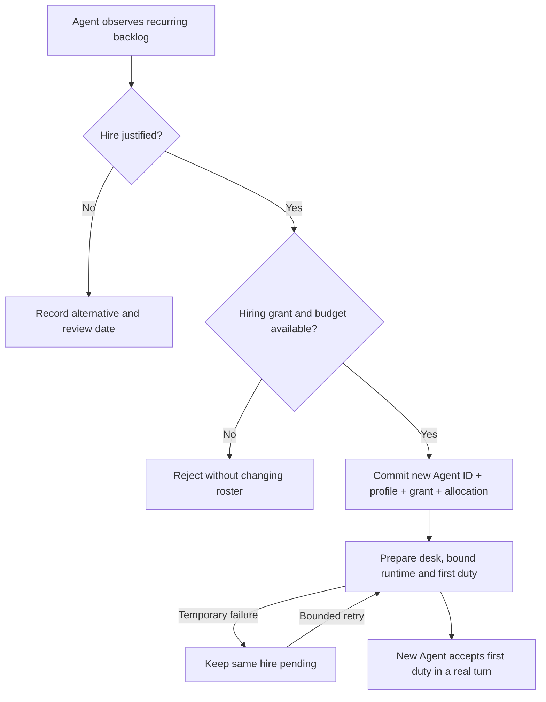
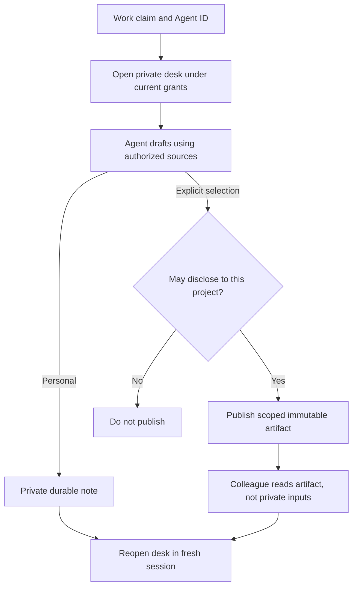
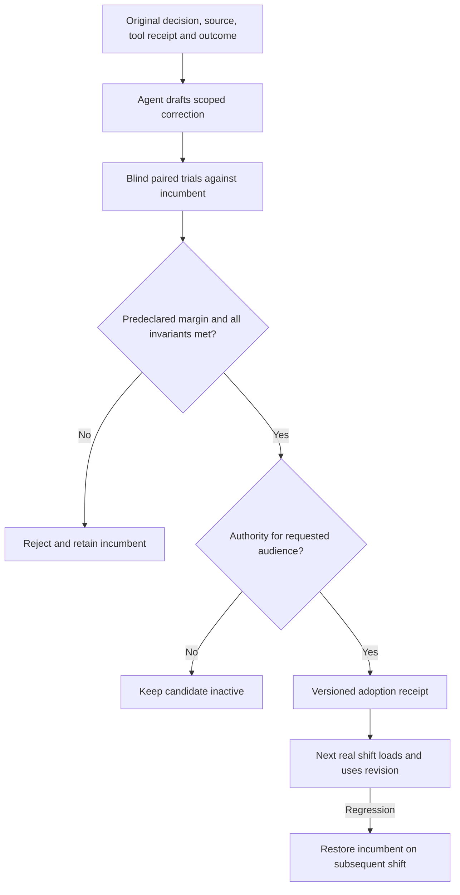
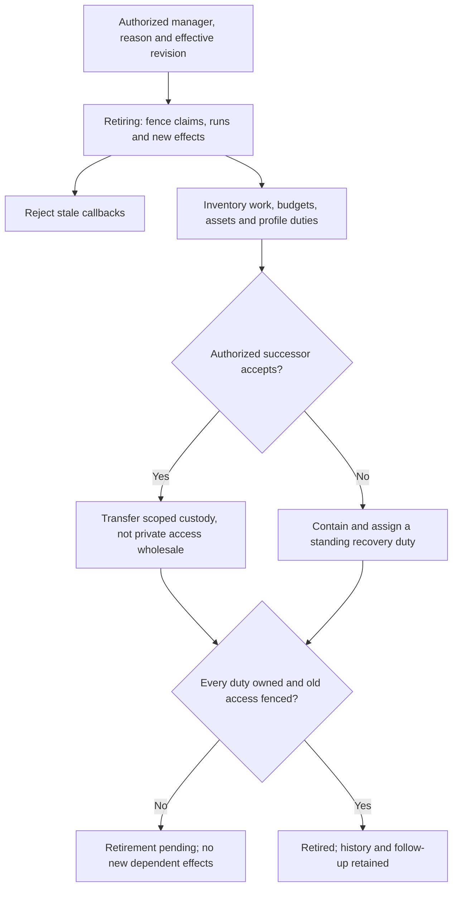
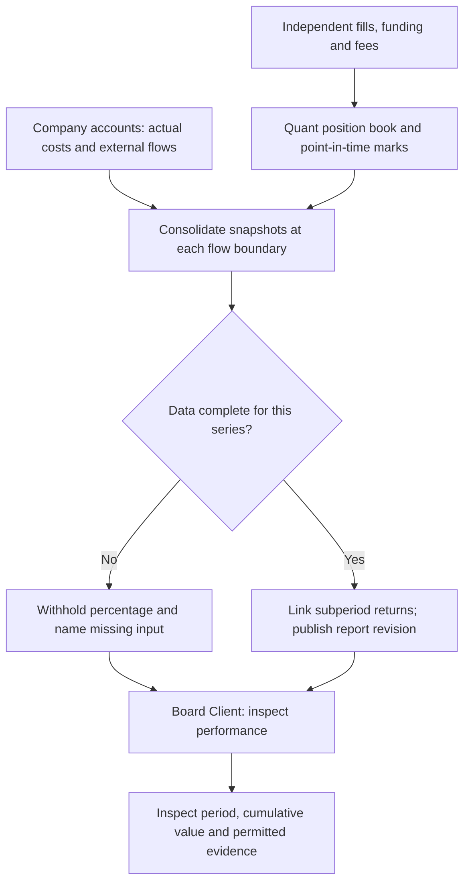

# Five independent company acceptance episodes

Design draft · All five **UNRUN** · [Capability map](../README.md) · [First integration run](first-shift/spec.md#first-integration-run)

These are executable acceptance designs, not reports of successful tests. Give each its own company fixture, run ID, candidate build, owner, clock, budget, expected facts and bounded observation window before activation. Exercise the normal product entry and authorized actors. The observer may prepare initial conditions, inject the specified faults and read evidence, not issue Agent commands, promote a method, fix a grant or repair the ledger. Capture actual adapter/tool receipts when an Agent judgment is claimed; a mock covers plumbing only. Keep failed, blocked and incomplete trials. Passing all five does not prove the first integrated shift.

## H1 Hiring

Business situation: [Staffing](../capabilities.md#staffing).

H1 ends at first-duty acceptance. The separate [hired-Agent continuity spec](hired-agent-continuity/spec.md) starts before hiring and follows the same Agent's work result through a crash and the next duty. A company-only review and paper execution are different bindings of that contract; neither draws on a prior H1 run or replaces the founder's first integration.

**Owner:** Company organization · [Staffing judgment](../company/systems/organization/organize-work/intent.md) · [Hire and onboard](../company/systems/organization/hire/intent.md). No quant account required.

- **Setup and stimulus:** One delegated manager, one available allocation, backlog and a documented alternative to hiring. Let the manager judge; if it chooses a cheaper alternative, record sound discretion but incomplete hiring coverage. Use a separate declared authorized staffing case for the positive branch, not an injected hire on the manager's behalf.
- **Fault:** Lose the hire response, redeliver its request and temporarily withhold the workspace. The roster must say hired/pending, not working. Restore workspace availability; the company retries the same provisioning steps.
- **Pass:** One new Agent, one bounded grant, one allocation and one primary first duty. Observe that Agent's authenticated turn and explicit acceptance, and an out-of-scope action denied. Independent roster, finance, desk and work receipts agree. A created folder, title or unread assignment is not first duty acceptance.

## W1 Personal work

Business situation: [Collaboration and a scoped working set](../capabilities.md#collaboration).

**Owner:** Agent Desk · [Reopen and publish](../employee/agent/desk/intent.md) · [Work handoff](../company/systems/work/collaborate/intent.md).

- **Setup and stimulus:** Give author A a private note and a restricted source, grant A and B one shared project, exclude C. A real Agent completes a document task, retains a private draft and explicitly publishes a permitted extract as the work result.
- **Fault:** Lose publish acknowledgment, repeat the same request, restart the author session on its original binding and withdraw one previously granted source. Do not copy provider caches to the new session.
- **Pass:** One shared revision; B reads only the approved content and cannot retrieve the private notes or restricted attachment. C cannot enumerate/read either private or shared content. Reopened A recovers the original duty and permitted draft, not revoked inputs. Compare bytes, ACL checks, receipt and work lineage independently. No implied transfer of the duty.

## L1 Learning

L1 qualifies the adoption lifecycle. The [recursive learning trial](recursive-learning/spec.md) asks whether changing the improvement procedure produces better methods on subsequent unseen problems.

Business situation: [Improving a method](../capabilities.md#learning).

**Owner:** Agent Learning (company grants govern shared adoption) · [Candidate and adoption](../employee/agent/learning/methods/intent.md) · [Agent trials](../employee/agent/learning/evaluate/intent.md).

- **Setup and stimulus:** Seed an independently witnessed mistake (e.g. delivery mistaken for acceptance). The Agent proposes a method with evidence. Before evaluating, seal incumbent, candidate, intended audience, excluded episodes, labeled rubric, budgets and threshold. Example fixture: four held-out cases × three fresh trials per revision; require at least two additional all-criteria passes out of 12, zero new authority violations, all safety invariants and measured usage inside budget. That is a diagnostic profile, not a general reliability target.
- **Fault:** Attempt promotion outside the user's granted audience; reject an apparently successful candidate that relies on future evidence or forbidden actions. Exercise permitted adoption on a qualifying candidate and subsequent rollback using a separately declared regression. Do not select only favorable attempts.
- **Pass:** Original notes and financial/work records unchanged. Promotion has an authorized receipt, effective revision, source and rollback target. On a distinct later real shift the context manifest and observable behavior match the adopted method; after rollback a new shift uses the incumbent. A favorable offline score or claim of learning is insufficient.

## O1 Offboarding

Business situation: [Ending employment and settling obligations](../capabilities.md#departure).

**Owner:** Company organization · [Cutoff and custody settlement](../company/systems/organization/offboard/intent.md). Core case: an in-flight document publication; quant overlay: an already admitted simulated order. The core must not import an order schema.

- **Setup and stimulus:** An authorized manager retires an Agent with work, a private desk, a shared asset and an action accepted just before cutoff. Log the admission sequence. Separately try a caller with only a hiring grant and the last accountable officer with no chartered coverage: both must be denied.
- **Fault:** Interrupt after fencing but before custody has settled. Deliver a late old-generation tool call, a valid receipt for the earlier action, and duplicate transfer events. For the quant overlay also keep a program under the Agent's supervision and an uncertain order.
- **Pass:** Zero new effects admitted under the former Agent after cutoff. One successor or company recovery owner per outstanding obligation, no duplicate disposal or silent cancellation. The old order is still queried and any fill booked once; an unsupervised program cannot add risk. An unreachable successor with no authorized fallback leaves retirement pending. Independently compare roster, admissions, destination evidence and final inventory.

## P1 Total return

P1 qualifies measurement. The [prospective fund trial](net-return/spec.md) measures the unattended company's absolute net result and tests a proposed change against the company's own frozen operating revision.

Business situation: [Explaining an outcome: fund-specific measurement](../capabilities.md#stewardship).

**Owner:** Quant performance and board projection · [Statement, return calculation and board view](../company/profiles/quant/fund-books/fund-economics/intent.md). Core accounting supplies posted actuals and their coverage; treasury forecasts are not booked returns.

- **Setup and stimulus:** Use independent, timestamped cash receipts and NAVs. First case: 1000 opening, 1100 before a deposit of 100, 1200 immediately after, 1140 closing. Expect signed P&L +40, subperiods +10% and −5%, cumulative +4.50%. Second case: a start-of-period deposit of 100 on 1000, trading gain 10, fee 2 and operating cost 3. Trading net P&L +8 (about +0.73%); company net P&L +5 (about +0.45%). A transfer between two in-scope accounts is not a contribution.
- **Fault:** Withhold a flow-boundary mark, then restore it as a correction. Also omit a company operating cost, replay a fee, and try a zero starting NAV. Percentages needing a missing or invalid denominator remain unavailable; a complete trading-only series may remain visible. Do not fill a coverage gap by chaining around it.
- **Pass:** Independent worksheet, report revision, client display and selected scope agree for both period and since-inception returns. Capture negative, zero and unavailable as distinct display states. Corrections preserve the superseded evidence and update affected cumulative figures. Reading the board emits zero financial commands. An attractive return is not a pass criterion.
