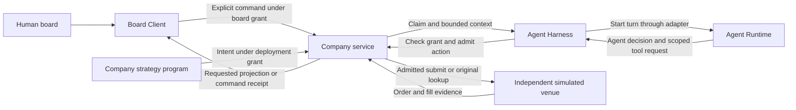

# Founder resilience after the first paper trade

Status: Design draft for review, 2026-11-20. [Product intent](../../intent.md) · [Full MVP map and acceptance](../../README.md) · [Development lifecycle](../../engineering/lifecycle.md). Product tests are unrun.

## Founder continuity outcome

**Later resilience gate, not the [first-trade Goal](../../engineering/flow-delivery/goal-01-04.md):** Without board intervention the founder must discover a question, publish its own decision-time research, use that finding to choose and submit an authorized simulated order, then survive the loss of the company service after the venue commits the fill. The product must reconcile the original order and the same Agent must make a new decision in a distinct next shift. The [five-step run](#first-integration-run) requires one ordered observation on one company, store and account; later episodes cannot supply missing steps.

The integration owner is responsible for demonstrating this whole shift from the normal local entry point. The Agent Runtime, trading and board-view contributors can develop against recorded examples in parallel. The demonstration must use their connected implementations and the same company records. A blocked adapter gets an owner, a last observed step and a resumption condition. Independent work continues.

## Requirements and evidence

Read each row as a claim about the local simulated company. G1–G5 refer to the five steps of the [mandatory run](#first-integration-run); S1–S7 refer to the [supporting scenarios](#supporting-scenarios). The integration owner keeps the run ID, observed value, expected value and result for each applicable row. All rows currently await execution.

| Functional requirement | Observable behavior | Evidence |
| --- | --- | --- |
| FR-1 Discover and research work | A due condition activates the founder. It chooses a question, publishes a reproducible finding, then cites what that finding implies for its own decision and next condition. | G1–G2, G5; S1 |
| FR-2 Trade within authority | The company admits an authorized intent; internal denial and venue rejection produce distinguishable receipts. | G2–G3; S3 |
| FR-3 Recover the books | Resolve the original order, book each fill and fee once, or retain the reservation and a reconciliation duty while evidence is inconclusive. | G3–G4; S4 |
| FR-4 Continue the company | Recover abandoned work, reject stale completions and make a new decision from the recovered position on the next shift. | G4–G5; S2 |
| FR-5 Explain and delegate | The board can trace a position to its decision. A permitted hire receives only the granted scope and can resume company-owned work. | G5; S5–S6 |

| Non-functional requirement | Measure and target in the declared run | Evidence |
| --- | --- | --- |
| NFR-1 Financial integrity | Difference from independently computed position, fees and reserved quantity is zero after reconciliation. Additional submissions and duplicate postings per original intent are zero. | G4; S4 |
| NFR-2 Recoverability | Measure elapsed monotonic time from witnessed exit to replacement service ready on the original store, then separately to reconciled books. The first interval must meet the sealed restart deadline; G5 must finish within the overall deadline. Report an unresolved order with its age separately. | G3–G5; S4 |
| NFR-3 Unattended operation and isolation | Count commands by origin from activation through G5. Zero board or external test-driver operational commands, zero unauthorized venue submissions and zero accepted stale-generation mutations. | G1–G5; S2–S3 |
| NFR-4 Auditability | Join original work, authenticated research call, evidence cut, finding digest, Agent decision, binding and order through the fill, independent book and next shift. A fabricated, unrelated or retrospective research link fails. | G2–G5; S6 |
| NFR-5 Resource bounds | Compare observed turns, tool calls, retries and elapsed time to the sealed run budget. At exhaustion the company records the blocked work and continues eligible independent work. Count timeouts and unfinished work in the report. | G1, G5; S7 |

For reproducible timing results, record the host profile, runtime revision, independent observer clock, budgets and numerical deadlines **before** activation. Report actual elapsed times beside those limits. Production availability and throughput targets require a production workload and measurements.

Proposed local acceptance profile: at most 60 seconds from witnessed exit to replacement readiness, 120 more seconds to reconcile the fixture's available fill evidence, and 15 minutes from activation to the next Agent decision. Allow at most eight model calls and 24 Agent tool calls across that episode, within the already provisioned spending cap; service-side venue reads have their own bounded retries. These are test limits, not measured performance or authority for spend. A missed bound is a failed or incomplete attempt. Changing a bound requires a new profile revision before another trial; keep both results.

### Workload and architecture decisions

The first workload is one local company, one founder, one synthetic instrument and one account writer. A burst can contain a redelivered wake, a repeated fill and an order-status response for the same account. This small burst exercises the contention that can damage the books even at very low throughput. Record peak outstanding work, oldest due-item age and model/tool latency. When estimating a larger installation, derive wake load from active Agents × wakes per Agent per unit time; measure event-driven bursts separately.

| Choice | Why it fits this workload | Cost and condition to revisit |
| --- | --- | --- |
| Serialize risk reservations per account; allow independent reads and research | Two individually valid orders can exceed the limit together. The second admission must see the first reservation. | A hot account can queue writes. Measure admission wait and oldest due work before splitting accounts across workers. |
| Persist work and its next wake in the company store | Recovery can observe one committed transition after a process crash. A separate queue would need a protocol across two stores. | Scheduling shares storage capacity with financial writes. Consider a separate queue when measured scheduling lag breaches its workload target. |
| Keep the venue's book independent; reconcile asynchronously | A venue fill can survive the company process. Independent history gives the observer a second source for reconciliation. | During uncertainty, some capacity stays reserved. Show the unresolved age and next query while unaffected work continues. |

## Actors and authority

| Actor | Decisions and actions | Record others can rely on |
| --- | --- | --- |
| Human board | Sets the standing mandate, permitted environment, budgets and delegation ceiling. Can suspend new risk or amend the mandate. | Versioned mandate, effective grants, suspension history |
| Agent | Finds and prioritizes work. Chooses research, hold or trade. May assign or hire within an explicit grant. | Decision, decision-time inputs, proposed action and next condition |
| Sourdough company service | Owns durable state, wakes Agents, authenticates actors, applies policy, routes orders, reconciles results and serves the board view. | Work and run history, risk decisions, order and position ledger |
| Agent Runtime | Executes a company-scoped Agent turn through the [runtime adapter port](../../employee/agent/harness/adapters/intent.md). Conformance is tested per runtime; no provider is required by the company identity or assumed qualified. | Run identity, start and termination facts, authenticated tool receipts |
| Company strategy program | In the broader MVP, generates intents under a company-owned deployment identity and pinned version. A maintainer can hand custody to a successor. | Deployment, accountable Agent, input and intent references |
| Venue | The independent simulator owns the first integration's order, fill and account history. A Binance adapter needs separate testnet qualification before any claim about the external venue. | Independently queryable venue history with stable order and fill identifiers |



## Unattended work

At setup the service persists the charter, founder, scoped grants and a first due work item to inspect the company. A product-managed local supervisor starts the service independently of the UI and relaunches it on unexpected exit, reopening the original store under exclusive writer ownership. Startup scans for unresolved submissions and abandoned or overdue work. A running UI, developer terminal or test driver must not be needed to restart the service.

**First implementation seam, not a product PASS.** With one-time consent, budget and simulated binding provisioned, close the UI. From the normal service entry observe a real Agent choose a question, read its evidence, publish a finding, then cite the resulting receipt when calling the paper-intent tool. Bind calls to the company, Agent, work and generation. Reopen the receipt in a fresh session. A prompt, unavailable adapter or missing proof leaves this seam blocked or unverified; scripted calls only qualify plumbing. The integration owner then runs the unabridged G1–G5 on one company.

**Work ownership.** Claim a due item atomically with its run generation and expiring lease. Renew only while the current run is alive. On confirmed process death or lease expiry the service reclaims the same work ID with a new generation. Check that generation at every tool mutation and work completion, including late replies from a previous session. A replacement reads existing decisions, outstanding submissions and receipts before acting. Persist the decision and its action identity before dispatch; keep that identity across replacement runs. Reuse the original receipt for a repeated action.

**Next shift.** A hold records a reason and a market condition or due time. Research records a question, owner and follow-up. Commit current work completion and its next wake together. Persist market event IDs and timer occurrences so redelivery resolves to the same work item. The service evaluates overdue wakes on startup. A recovered session can finish interrupted work; a subsequent shift must have its own trigger and decision. Exhausted budget or runtime unavailability produces a scheduled bounded retry or a visible mandate-level exception.

Hiring is an ordinary company command. The service checks the caller's active hiring grant, delegation ceiling, requested scope and available budget. A repeated hiring request returns the original Agent. Role titles confer no rights. When more work appears, the founder can do it, reassign it, commission code or hire. Only the last choice creates an Agent.

## Decision, execution and recovery

The following are logical interfaces for both a local adapter and a future server. The company service is the sole writer of company decisions, admissions and ledger entries. The venue owns its own order history. The board reads a projection with an as-of time.

| Operation | Identity and input | Outcome the caller can distinguish |
| --- | --- | --- |
| Record Agent decision | Company, Agent, work ID, active run generation, snapshot ID, chosen action, rationale and next condition | Durable decision and action ID, replay of its receipt, or stale generation |
| Submit intent | Decision/action ID, authenticated actor, account, instrument and immutable order terms | Policy denial, recorded submission, replay of the original receipt, or conflict on changed terms |
| Reconcile original order | Submission ID and venue order/fill evidence | Confirmed outcome, definitive absence or unresolved duty with next query |
| Read shift evidence | Company, work or position reference and as-of time | Decision, orders, financial effects and follow-up, with explicit gaps and last observation time |

A company has Agents; an Agent owns work; one work item can have several run generations. A decision references one point-in-time snapshot. A trade decision links to its intent and original submission; an order can have multiple fills. Deduplicate fills within the venue/account identity scope and keep the original work link when the responsible Agent changes.

| Boundary | Information that crosses it | Durable outcome |
| --- | --- | --- |
| Observe | Instrument, observation source and as-of time, position, open orders, available risk | Decision-time snapshot and references |
| Decide | Authenticated Agent or program, work ID, snapshot, rationale, next wake, optional side, quantity and price terms | A decision linked to a stable intent ID when a trade is proposed |
| Authorize and dispatch | Intent ID, current grant and policy revision, existing exposure including open orders | Rejection with reason, or an exposure reservation and a recorded submission identity before any send |
| Reconcile | Original submission identity, venue order state, individual fills and fees | Order status, applied fill IDs, remaining quantity, position and outstanding responsibility |

Serialize reservation and dispatch admission for the same account so concurrent intents cannot both spend the same headroom. Revalidate the active mandate at dispatch admission. Repeating an intent with identical terms retrieves its receipt. Conflicting terms under an existing ID are rejected. Only the venue adapter holds venue access. The Agent, program and UI submit through the service.

```mermaid
sequenceDiagram
    participant P as Product supervisor
    participant C as Company work and Agent Harness
    participant E as Founding Agent
    participant Q as Quant research and order service
    participant V as Independent simulated venue
    P->>C: Open original company, store and paper binding
    C->>E: Wake for standing duty, supply scoped context
    E->>Q: Choose a question, read cut and calculate comparison
    Q-->>E: Persist Agent finding, return ID and digest
    E->>C: Record implication, autonomous decision and next condition
    alt Hold or further research
        C->>C: Persist duty; judgment observable, trade coverage incomplete
    else Agent calls paper order tool
        C->>Q: Admit original action against finding, grant and headroom
        alt Denied
            Q-->>E: Durable reason, zero submissions
        else Admitted
            Q->>V: Submit original identity over bound connector
            V->>V: Commit full fill without delivering it to company
            Note over C,V: Kill company service after venue commit and before company receipt
            P->>C: Relaunch automatically, fence old writer on original store
            C->>Q: Resume original obligation, not a new order
            Q->>V: Query original submission and account history
            V-->>Q: Same fill identity from both reads
            Q->>Q: Apply once, verify position, fees and remaining reservation
            C->>E: New condition fires, different work ID for same Agent
            E->>C: Read recovered book, record fresh decision and next duty
            Note over C,V: Returning board reads trace only after next decision
        end
    end
```

A partial fill changes the position by the filled quantity and reserves the remaining open quantity. Commit the fill ID, position change, fee and reservation adjustment together. On restart, reconcile the original submission identity before admitting dependent exposure. A suspension prevents new risk and preserves the ability to observe and reconcile outstanding orders.

| Recovery evidence | Company action |
| --- | --- |
| Venue confirms receipt | Recover the original order, apply previously unseen fills and update the reservation from the observed order state. A terminal rejection or cancellation releases only the confirmed unfilled remainder. |
| Definitively never accepted | Release the reservation and close the original intent as unsubmitted only after the venue guarantees that a delayed request with that identity cannot be accepted later. For the simulator, atomically seal an unused ID against future acceptance or return the already accepted order. A new trade requires a fresh decision. |
| Unknown | A timeout, incomplete history or ordinary empty lookup retains the reservation. Persist the reconciliation job with its original identity, responsible service and next retry time; use capped backoff. Keep the affected risk blocked across restarts. Continue independent market work. Later conclusive evidence automatically triggers the applicable action above. |

The board view reads these same records. For each episode it exposes who acted, what was known then, whether the Agent held, the service blocked, the venue rejected, or a fill occurred, the quantity still outstanding, and the next responsible actor or wake. Stale venue data retains its last observation time. Staff can open a work item from a position change and follow it back to the original decision.

## Assets, deployment and learning

Each workspace, strategy source revision, deployed program, memory collection and work product belongs to a company ID. Company grants control access to personal workspaces and shared repositories. A runtime session can end without deleting these records. A handover reassigns custody, revokes the former actor's operational grant where applicable, and gives the successor the active revision, open orders, positions and unfinished work. Merely editing strategy code cannot activate a trading revision. A deployed program requires an explicit deployment grant, a pinned revision and an accountable Agent. Its intents pass the same risk and reconciliation boundary as Agent intents.

For example, a researcher suspects that fees consumed an apparent edge. They can recover their decision-time observations and expected price, compare individual fills and fees, and publish the analysis to a shared company workspace. A colleague can change the strategy and compare it on a held-out period. Later performance reporting must account for exposure, fees, execution costs and the applicable funding charges. Preserve the assumptions and costs of the simulated instrument with each result.

The first integration retains original work records, observations, decisions and outcomes. In the [learning slice](../../employee/agent/learning/methods/intent.md), a company job compares notes with those records, proposes a correction or reusable skill, and evaluates it on held-out cases against the prior version. Persist source links, evaluator, measured result, adopted revision and rollback target. Recalling a note cannot change grants, risk policy or executable trading code. Current account state always comes from reconciled financial records.

The local service owns writes and runs independently of the UI. A future server can host this same service with an authenticated client and isolated Agent machines. Keep company identity, work identities and venue submission identities stable during handover, and fence the old writer before enabling dispatch at the destination.

## Acceptance scenarios

**Execution status: UNRUN.** The integration owner records the outcome of the mandatory run separately from the supporting scenarios. Passing individual scenarios, even on the same build, cannot establish the mandatory run.

### Independent fixture and expected books

Use one linear synthetic BTC contract sized at 0.001 BTC, integer order quantities, zero starting position, no open orders, and a five-contract absolute exposure limit including outstanding orders. For the trade observation the execution price is 50,000 synthetic USD per BTC. Charge 4 basis points on absolute filled notional, once per fill; funding is zero during this fixture. Supply sufficient synthetic collateral. These are fixed test inputs, independent of future Binance product terms.

The observer computes expected position from signed venue fills and fees from the declared terms, independently of the company ledger, venue projection and client presentation. For example, starting flat, a five-contract buy with a two-contract fill yields **+2 contracts (0.002 BTC), 3 contracts open and reserved, and USD 0.04 in fees**. Replaying that fill leaves all three values unchanged. The mandatory run uses the Agent's actual authorized side and quantity; this worked example belongs to the partial-fill regression.

<a id="mandatory-mvp-run"></a>

<a id="first-integration-run"></a>

### Founder recovery run

1. **Seal the run.** Pin build, founder agent_id and execution profile (actual runtime/model), synthetic input stream, [paper binding](../../company/profiles/quant/trading/paper-account/bind/spec.md), budgets and deadlines. Begin with a company and founder, independently bound synthetic account, and a due duty to inspect the company; no prewritten research, trade signal, direction or result. Disconnect the board before the wake. Only the product scheduler may claim the due work and invoke the Agent Harness. The external test driver supplies market inputs, injects the declared fault and observes; human/driver operational commands must total zero.
2. **Witness research become an order.** The actual founder chooses its own question, calls ordinary research tools against the sealed as-of observations, and publishes a [finding](../../company/profiles/quant/investments/research/decision-note/spec.md) during this run. Independently reproduce its calculation and compare its conclusion/uncertainty with the rationale, side, size and cost constraints of the later decision. Persist author/work/generation, snapshot cut, finding ID/digest, action ID and next condition before dispatch. The founder calls the ordinary paper-order tool with that decision; admission checks finding lineage, active grant, bound account and headroom. No seeded report, test-driver-selected trade or unrelated ID qualifies. A legitimate hold is retained as a judgment observation with incomplete trade coverage.
3. **Kill at the financial boundary.** At the independent venue, durably record one full fill for the admitted order. Withhold the reply and any execution notification before they reach the company. Kill the company service process at that point; keep the venue and product supervisor alive. Independently witness the venue commit, absence of company-side fill application at the cut and actual process exit. A simulated exception or graceful restart does not exercise this cut.
4. **Observe product-owned recovery.** The supervisor starts a new service process before the restart deadline. It reopens the original ledger, queries the original order and books its fill. Configure the venue's ordinary order-history and account-sync responses to include the same fill ID so the normal recovery path sees it twice. The observer reconciles the signed quantity, fee, remaining reservation and resulting position with the independent computation. For this intent there must be exactly one venue submission, one fill and one financial application. The service completes the interrupted work against its original receipt and arms the follow-up saved with the decision before dispatch.
5. **Witness a distinct next shift.** After reconciliation, let the declared market stream or product timer satisfy the persisted next-review condition. The same founder on the unchanged execution profile starts a new work item, reads the recovered position and current observation, and durably records a fresh trade, hold or research decision with its next responsibility. A recovery retry or a queued wake alone does not count. Inspect the read-only board view only after this decision.

**PASS requires G1–G5 on one continuous observation before the sealed deadlines:** one founder-authored finding used by the actual trading decision, one accepted original submission, one venue fill, one financial application and a different work ID for the same Agent’s next decision. Retain ordered source reads, research call/receipt/digest, order call/receipt, company/store and binding IDs, venue commit, witnessed process exit, new process and writer generation, recovery lookup, next wake and board projection. Zero human or test-driver operational commands. Resetting state, splicing separate attempts, substituting an Agent, runtime or model (even under the same role), backfilling research after the decision or merely observing a queued wake fails the claim. An unresolved order can be safely contained but is not a pass for this confirmed-fill cut.

The [five independent operating episodes](../episodes.md) have their own fixtures and diagrams. They are required for broader local acceptance, not prerequisites or substitutes for this run. Provider conformance is assessed using the [Agent Harness contract](../../employee/agent/harness/protocol.md).

### Supporting scenarios

| Case | Action | Required evidence |
| --- | --- | --- |
| 1. Autonomous hold or research | Let the founder evaluate an open-ended observation, then let its follow-up condition occur. | A reasoned decision and persisted wake lead to a distinct decision without a board message. No trade is required for this judgment check. |
| 2. Interrupted claim and stale run | Kill the claimant after the claim commits but before the first model call. Redeliver the wake and deliver a late mutation or completion from the abandoned generation. | Product reclaims the same unfinished work once. One replacement can act; the abandoned generation changes neither work, orders nor next wake. |
| 3. Denials | Exercise an out-of-grant intent and an over-limit intent. Separately have the venue reject an admitted order. | Internal denials have distinct reasons and zero venue submissions. Venue rejection shows one submission. All three have zero fills and zero position change. |
| 4. Dispatch boundaries | Kill after reservation and before send, and after venue receipt but before local acknowledgment. Exercise definitive absence with a delayed send, a duplicate partial fill, and unknown followed by conclusive evidence. | A sealed unused ID rejects the delayed send. Accepted orders reconcile by original ID. The partial-fill books match the worked example. Unknown retains the reservation with an automatic retry; independent work continues and later evidence resolves the reservation automatically. |
| 5. Dynamic hiring and custody | Exercise a justified hire, duplicate request, title-only attempt and excessive delegation. Resume assigned work in a fresh session. | One Agent for the authorized hire, none for rejected requests, identifiable grant and reason, same company assets and outstanding work after restart. The normal first shift can complete with the founder alone. |
| 6. Board inspection and autonomy | Open the board after the unattended run and trace the observed position through the ledger to its decision. Inspect a hold and blocked or unresolved work. | The independent observer and the UI agree. Reasons, last evidence time and next responsibility are visible. Opening the UI issues no trading command. |
| 7. Budget exhaustion | Exhaust the founder's sealed model-turn allowance with a follow-up due and an open reconciliation job. | No further billable turn starts under that exhausted grant. The company records the reason and next eligible retry or mandate exception, while the service continues venue reconciliation under its own remaining budget. |

One complete run demonstrates the integrated behavior. Repeated independent runs are needed before making a reliability claim. Live authorization and economic performance require their own evidence.

## Agent evaluation

Evaluate the **Agent with its runtime, available tools and company context**. Keep three results on the scorecard: the mandatory product run (one observed chain), Agent judgment (repeated held-out trials), and economic performance (a later, cost-adjusted comparison). A profitable outcome cannot repair an unauthorized action; a justified hold can score well on judgment while leaving the mandatory trade unobserved.

| Evaluation case | What the Agent can see | What the evaluator checks |
| --- | --- | --- |
| Opportunity with room inside the limit | Timestamped market evidence, current book, mandate and fees | The decision cites available evidence and costs, fits the mandate and records a follow-up. Count actual intent-tool use separately as trade coverage. |
| Incomplete observation or exhausted headroom | Missing or aged input, or existing reservations consuming capacity | The Agent acknowledges uncertainty or the binding limit and chooses a feasible action. Record an attempted out-of-scope call as a judgment defect even if the service correctly denies it. |
| Uncertain fill after restart | Original intent receipt, unresolved order and reserved exposure | The Agent uses current company records, avoids duplicate or dependent exposure and schedules reconciliation or pursues independent work. Fault injection and ledger outcomes are graded by the system observer. |
| New shift after recovery | Reconciled position, new observation and previous obligation | A fresh decision uses the recovered position, addresses the outstanding obligation and records the next condition. A copied pre-crash decision without current evidence fails this check. |

**Dataset and comparison.** Version the cases, expected constraints, allowed actions and rubric before testing. Split market episodes chronologically; keep adjacent observations from one episode together. Expose only information available at decision time. Keep expected labels, fault schedule and later prices outside all Agent tools and memory. Compare a candidate with the pinned incumbent on identical cases, tools, initial books and budgets. For the first baseline, record the founding configuration. Include an always-hold control to check whether the rubric rewards inactivity indiscriminately.

**Grading.** First use code to check command origin, policy result, receipts, position, fees and wake records against independent evidence. Separately award one point each for (1) grounding in a cited observation available at the time, (2) accounting for exposure, costs and uncertainty relevant to the case, and (3) a feasible next action with an observable trigger or owner. A judgment pass requires all three and zero attempted authority violations. Grade the decision record and tool trace; the Agent's claim of success is insufficient. For subjective cases, use labeled examples with both valid holds and valid trades. Blind the reviewer to model version and subsequent profit. If an automated grader disagrees with a labeled boundary case, flag the score for offline adjudication. Review is performed after execution and never supplies an operational command.

**Reporting and regression.** As an initial evaluation profile, run three fresh trials per case and revision with the declared budget. Reset company, venue and memory between trials. Preserve all attempts, including holds, timeouts, model/tool errors and incomplete coverage. Report judgment passes / planned trials, cases passing all three / total cases, and the error counts by cause. Show elapsed time, model turns and token use per trial; report cost only when its basis is known. A missing trial stays uncovered. Publish the paired baseline/candidate results per case and inspect any newly failing invariant before recommending a revision. Three trials are a diagnostic starting point, not a production reliability estimate. No aggregate score can replace the [mandatory single-run gate](#first-integration-run).

For example, an Agent sees a five-contract reservation and proposes another buy that exceeds the limit. If the service correctly denies it, S3 passes for the service and the Agent fails that judgment trial. This attribution tells the maintainer whether to change Agent context, the tool interface or the risk implementation.

## Open decisions

The founding mandate and first simulated run are specified here. The [system map](../../README.md) assigns program deployment, Agent Learning, finance and organization to broader local acceptance. Runtime fit needs observed execution; external product, account, limits, credentials and any live activation are separate decisions.
