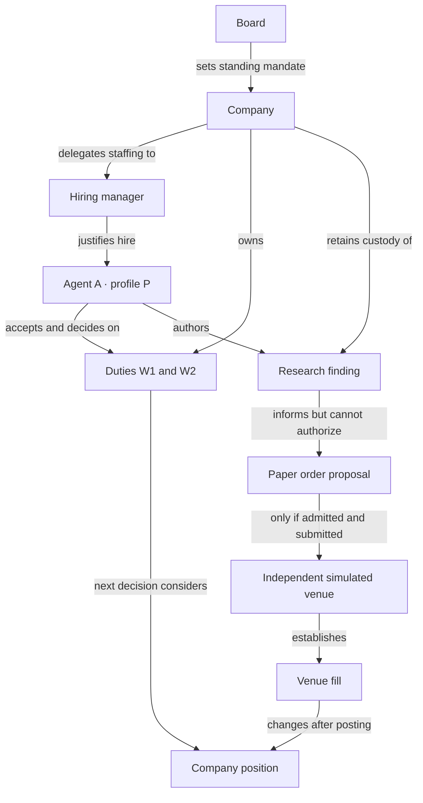
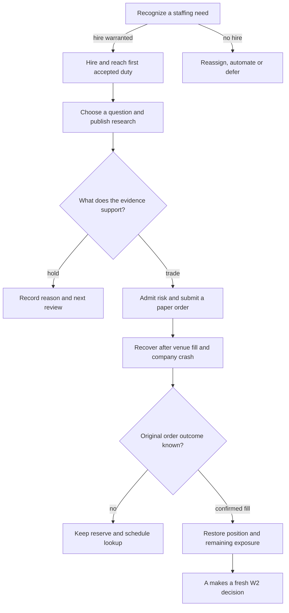
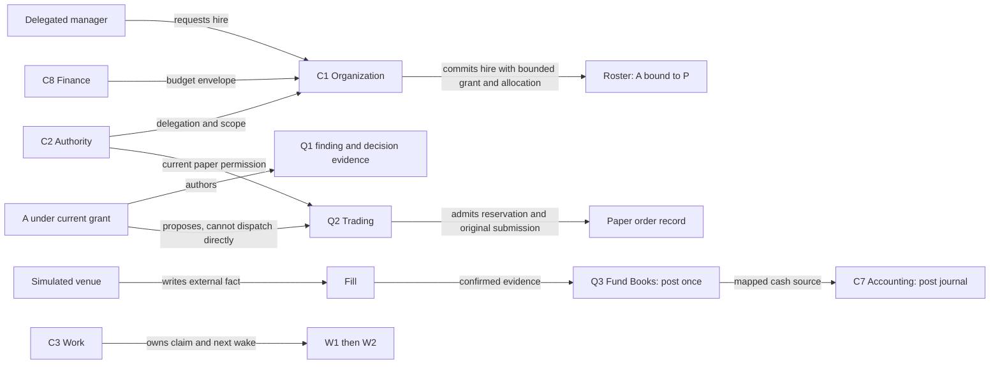
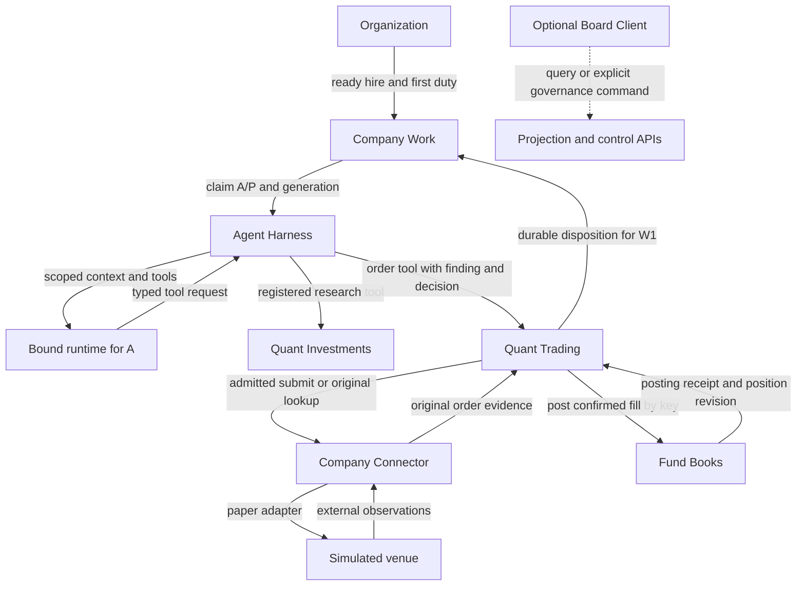
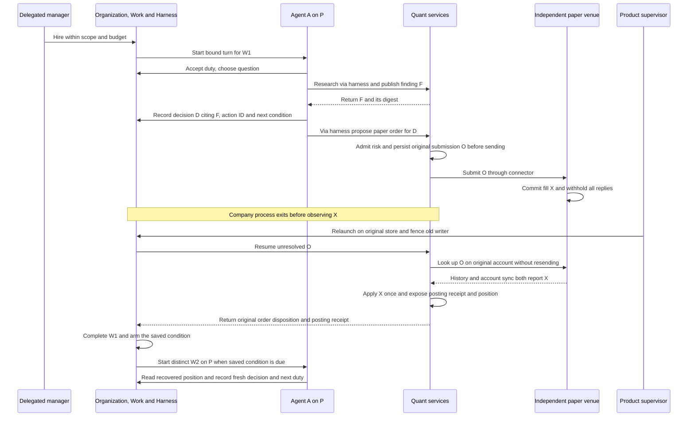
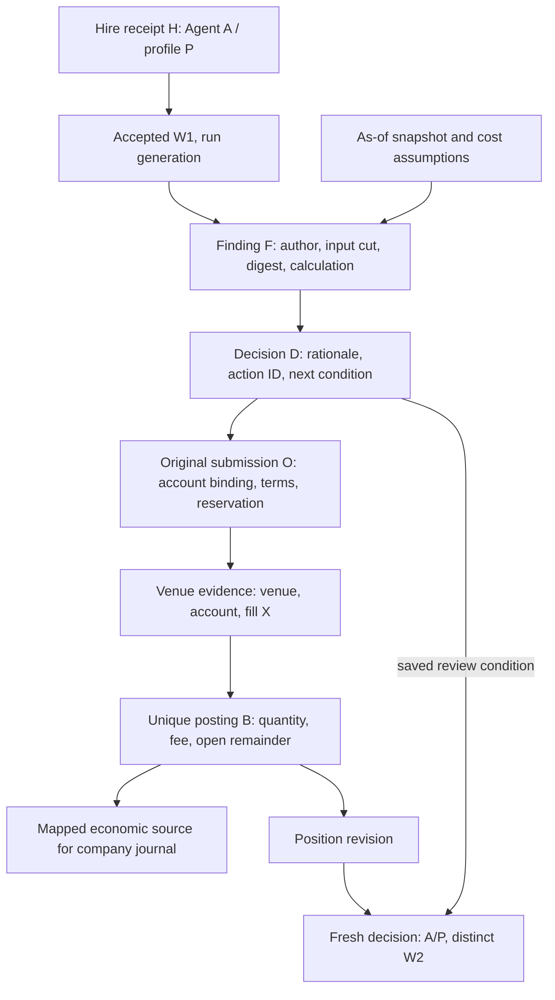
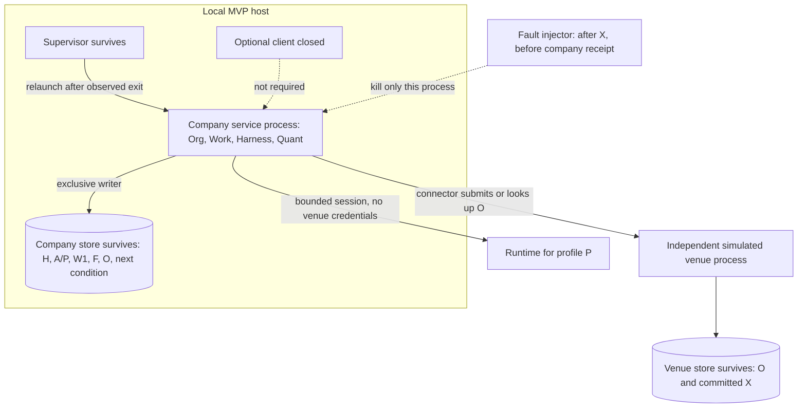
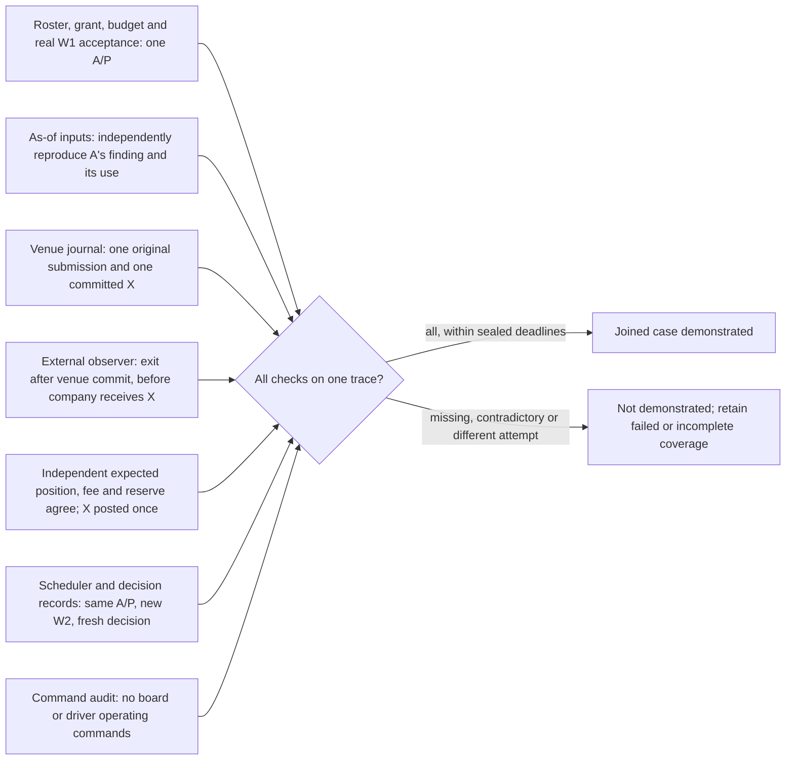

# Worked example: a newly hired Agent at a paper fund

[Role-independent architecture atlas](../../views.md) · [System map](../../README.md) · [Feature index](../../capabilities.md) · [Glossary](../../glossary.md)

## The case shared by all eight views

The [role-independent integration contract](spec.md) follows **hire → evidence-based judgment → durable result → crash → verified recovery → next duty**. These eight drawings illustrate its paper-execution binding, not a job description for all Agents. In the company-only binding the durable result is an assessment revision and the next duty reads that revision; there is no venue, order or position.

A manager operating under the standing mandate judges that a hire is warranted. Organization hires **Agent A** on immutable execution profile **P**. A accepts a general observation duty **W1**, chooses a research question, publishes a finding, and, in the illustrated branch, decides to propose a **simulated** order. The independent venue commits a full fill. The company service dies **before receiving either reply or notification**. It must recover the position and the same A/P must make a fresh decision on a distinct duty **W2**. The board and client are absent throughout normal operation.

These are example correlation labels, not implementation IDs. **P** is the Agent's execution profile; the paper account binding is separate. Hiring and trading are discretionary: declining to hire or choosing to hold can be sound decisions, but do not exercise this branch. This is a joined **design walkthrough, UNRUN**. [H1](../episodes.md#h1-hiring) tests an actual hire; the mandatory [G1–G5](../first-shift/spec.md#first-integration-run) starts from an existing founder. Neither their separate results nor this diagram proves a hired Agent completed both in one run.

[1 Domain](#company-model) · [2 Capabilities](#business-capabilities) · [3 Authority](#decision-and-write-authority) · [4 Components](#logical-components-and-interfaces) · [5 Runtime](#session-recovery-versus-succession) · [6 Information](#records-and-lineage) · [7 Deployment](#local-fault-boundaries) · [8 Evidence](#quality-scenarios) · [Boundary review](#follow-one-decision-across-views)

## Company model

**1 · Context and domain.** Arrows are business relationships, not calls. A role may pass to someone else; authorship and identity do not. Company custody of a finding does not give every Agent access to its author's private desk.

The manager acts for the company, not the board. A new session on P can serve A; an alternative runtime requires another Agent. Neither a market venue nor a model provider is an officer of the company.

## Business capabilities

**2 · Outcomes.** These are abilities, not a fixed department chart or a script for the model. Two branches matter: a justified hold has no order to recover, and an unknown order has no proven fill to book. [All capabilities](../../capabilities.md).

## Decision and write authority

**3 · Who may write which fact?** Arrows identify the decision maker or authoritative writer, not deployment boundaries. C/A/Q labels refer to the [ownership matrix](../../README.md#system-hierarchy).

A hire, title or finance allocation does not grant paper dispatch. The illustrated hire requests explicit paper scope within delegated limits; Q2 still checks that scope, account, mandate, evidence and remaining risk when the order is admitted. Without it, research can succeed with zero submissions.

## Logical components and interfaces

**4 · Which contracts cross the boundaries?** Arrows are calls or returned evidence. Company Work can run without Quant; enabling Quant registers tools. The connector is not an order approver, and the Board Client is not an operational dependency. [Component contracts](../../architecture.md#dependency-and-authority-boundaries).

The harness executes A's tool requests; it neither authors the research nor writes the financial record. The APIs expose service-owned records and authorized commands. Closing the client cannot interrupt a run or suppress a wake.

## Session recovery versus succession

**5 · Runtime behavior.** Read top to bottom. The response deliberately never reaches the original company process. A restart is not an order retry. The fresh work ID, not just the new process or run generation, identifies the next shift.

If P is unavailable, block A's turn; Q2 can still reconcile O. A separately authorized successor can accept an explicit [handoff](../../company/systems/work/collaborate/handoff/spec.md), but cannot become A or pass A's W2 check. A delayed callback from the old generation cannot reopen W1.

## Records and lineage

**6 · What proves causality?** Arrows are durable references, not steps that can be recreated from a transcript. An auditor must be able to follow the decision backwards to the data A saw and W2 backwards to the posted position. [Research receipt](../../company/profiles/quant/investments/research/decision-note/spec.md) · [Fill posting](../../company/profiles/quant/fund-books/book-fills/post/spec.md).

A matching finding ID alone is insufficient: independently reproduce F and check that D used its implications. Preserve the original attribution after recovery; a position snapshot alone does not show why the company traded.

## Local fault boundaries

**7 · Deployment and survival.** Boxes are failure units, not teams. The first cut kills **one company process**, not the whole machine, provider, supervisor, or venue. Restart must use the existing store and account; opening an empty company is not recovery.

A machine/storage loss exercises a [different restore contract](../../company/systems/operations/restore-company/intent.md). Neither the observer nor an open UI relaunches the service. A venue that shares the company's process or rolls its fill back with the company cannot test this boundary.

## Quality scenarios

**8 · Evidence and falsification.** This is a join of independent observations with **AND** semantics, not a software pipeline or eight ways to count the same log. All evidence must refer to one continuous attempt. The test driver may inject the declared fault, never the research, order or next wake.

A correct hold, protected unresolved order, blocked hire, or safe transfer to B is reportable, not a pass for this case. Compare [G1–G5 and its failure scenarios](../first-shift/spec.md#first-integration-run), [H1](../episodes.md#h1-hiring) and the [judgment trials](../../employee/agent/learning/evaluate/run-trials/spec.md). This test establishes neither profit nor external exchange readiness.

## Follow one decision across views

| Boundary found by following A | Who owns the handoff; what breaks the tie | What would expose a gap |
| --- | --- | --- |
| **Roster vs readiness vs permission.** C1 creates the hire; A4 defines P; neither fact proves that A can work or trade. | [Onboarding](../../company/systems/organization/hire/onboard/spec.md) stays pending until A actually accepts W1. C2 checks grants and Q2 admits only bound paper risk. | Replay the hire after a lost reply; expect one A and allocation. With research-only scope expect a finding, a denial and zero sends. |
| **Research author vs evidence custodian.** W1 and the grant identify A, while Q1 stores F; neither a stored note nor a typed tool call proves judgment. | [Research](../../company/profiles/quant/investments/research/decision-note/spec.md) owns the immutable cut and digest; [risk admission](../../company/profiles/quant/trading/admit-intent/reserve/spec.md) checks the link before dispatch. | A prepared finding, a future input or an unrelated finding must not establish the research-to-order case. |
| **Lookup vs posting vs general journal.** Reconciliation and posting both described “applying” the same fill. | [Q2 reconciliation](../../company/profiles/quant/trading/recover-order/reconcile/spec.md) owns original lookup and outstanding risk; [Q3 posting](../../company/profiles/quant/fund-books/book-fills/post/spec.md) alone books a confirmed fill and its reservation adjustment. [C7](../../company/profiles/quant/fund-books/book-fills/journal-source/spec.md) posts only mapped cash effects by source. | Return X via two feeds; expect one position/fee change. Lose the journal ack; replay must not subtract the fee twice. Inconclusive lookup retains the reserve. |
| **Process restart vs financial recovery vs next shift.** A healthy process or an armed timer is not evidence of either. | Supervisor restarts; Q2 obtains the Q3 receipt; C3 resolves W1 and issues W2 from the saved condition. The actual A/P reads the recovered position before deciding. | Race a due timer with reconciliation. No position-dependent W2 decision on pre-fill state; stale W1 callback and redelivered wake produce no duplicate action. Unrelated work may continue. |
| **Coverage boundary: H1 ends at first acceptance; G1–G5 starts with a founder.** | The [hired-Agent contract](spec.md#scenario-bindings) owns the uninterrupted trial. For this binding, record H → A/P → W1 → F → O → X → B → W2 with no reset. | Combining two reports cannot prove this chain; a complete paper trace cannot establish continuity for a company without Quant. Both binding results are **UNRUN**. |

These drawings are design contracts, not execution evidence.
