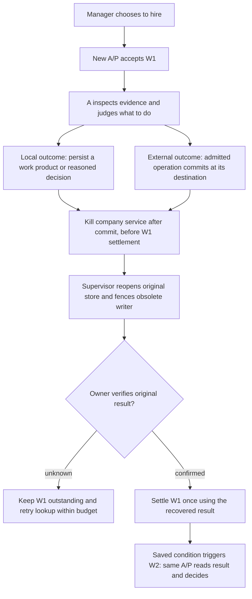

# Unattended work continuity for a newly hired Agent

Design draft · Verification **UNRUN** · Integration owner: company acceptance · [Product intent](../../intent.md) · [Acceptance map](../../README.md#integration-and-completion)

Business situations: [staffing](../../capabilities.md#staffing), [judgment](../../capabilities.md#judgment) and [continuity](../../capabilities.md#continuity). The employee is the organizational subject; the technical oracle uses the bound Agent identity. Hiring and fault injection are conditions of **this** test, not stages required of every employee duty.

## Claim and scope

A company hires an Agent to meet an observed need. The new Agent accepts work, uses evidence to exercise judgment within its grant, and leaves a durable result. The company crashes after that result exists but before the interrupted duty is settled. Without board intervention, the company recovers the result, and **the same Agent uses it to make a fresh decision on a distinct later duty**. These facts must occur in one observed attempt, beginning *before* the hire.

A duty can produce an assessment, a recommendation, a shared artifact or an authorized change to another system. A decision to take no external action can itself be the work product. No department, financial account, connector write, research report format or second hire is a prerequisite of the common contract. A role describes responsibility; it does not grant permissions.

This spec does **not** change the [founder's first integration (G1–G5)](../first-shift/spec.md#first-integration-run) or the [hiring episode (H1)](../episodes.md#h1-hiring). H1 stops at first-duty acceptance; G1 starts with an existing founder. Neither, nor their concatenation, establishes this claim.

## Contract between Work and the domain

| Owned by | Contract for the trial | Not its responsibility |
| --- | --- | --- |
| Organization, Authority and Finance | A real delegated manager evaluates the need. An authorized [hire](../../company/systems/organization/hire/issue-grant/spec.md) creates one new Agent A on immutable execution profile P, with bounded grants and allocation. [Onboarding](../../company/systems/organization/hire/onboard/spec.md) records actual acceptance of W1. | The board, fixture and role title cannot stand in for a staffing decision or effect permission. |
| Company Work and Agent Harness | Authenticate A/P and current claim generation. Persist A's evidence references, decision, stable action or work-product key, and next condition before external dispatch or no later than the local result commit. Retain an unresolved duty across process death. | Work does not interpret orders, document contents or reconciliation rules. The harness neither supplies the decision nor applies the domain result. |
| Owning domain | Define the authoritative store, commit witness, recovery lookup, result key and version, replay rules, and a separately computable expected result. Return a durable disposition and result reference to Work. | A transport acknowledgment, rendered projection or model claim is not a canonical result. |
| Supervisor and scheduler | Relaunch the original company under exclusive writer ownership, fence stale claims and [reclaim W1](../../company/systems/work/resume-work/recover-shift/spec.md). A due condition alone cannot release a result-dependent decision. | Restarting a process is not settling W1. A replacement actor cannot fulfill the same-Agent criterion. |

The **execution profile** P fixes A's runtime/model binding; the **scenario binding** below describes only how an observer tests a domain. Adding a binding changes neither the Agent nor the Work schema.

## One continuous attempt

**Seal before activation.** Record attempt/build, company/store, initial roster (A does not yet exist), manager grant, capacity and staffing need, execution-profile choices authorized for this trial, scoped inputs and their availability times, scenario binding, and baseline resource state. Pin finite restart and end-to-end deadlines, retry/turn limits and cost ceiling. Record the clock and independent observer for each boundary. Disconnect the board and close the client before the manager wakes. Only the product may hire, grant, decide, submit, restart, reconcile, wake or repair. The driver may provide sealed environmental inputs, observe and inject the declared fault; it cannot select the Agent's answer or issue an operating command.

| Gate | Action through normal product paths | Required independent evidence |
| --- | --- | --- |
| J1 · Hire and accept | A real manager chooses hiring over the alternatives. A is not the founder, manager or a previously dormant Agent. A accepts the first duty W1 in a genuine turn on P. | Initial/final roster delta for this request: one hire, one allocation, correct grants and P. Join manager decision and hire receipt to the authenticated acceptance by A; a provisioned workspace is insufficient. |
| J2 · Judge and act | A selects a question or next action based on W1 and the evidence it can actually access. It authors the work product/decision and records its rationale, evidence cut and next condition. Only an authorized action may follow. | Observe A's ordinary reads/tool calls and receipts. Check the result against the sealed source independently, and check how it supports the chosen action or deliberate inaction. A plausible transcript, prewritten output or unrelated artifact ID fails. |
| J3 · Cut after commit | The binding's authoritative owner durably commits the selected result. At the predeclared barrier, before W1 settlement, kill the **company service process** without graceful shutdown. | Independent ordered witnesses for commit, absent downstream acknowledgment/completion as specified by the binding, and actual process exit. The supervisor and authoritative storage survive. A thrown exception or post-settlement kill is not this cut. |
| J4 · Recover the original | Product supervisor relaunches within the sealed deadline on the original store. New writer/claim generation fences the old one. The domain resolves the **original** result by stable key; exercise duplicate observation or receipt delivery. Work settles W1 once and arms its saved follow-up. | Compare process/writer generations, original key, canonical version, domain observations and dispositions. Count one logical result/application, no duplicate mutation and no manual repair. If unresolved, retain its owner and next lookup; never infer success from silence. |
| J5 · Decide again | The saved timer or event makes W2 due. If it arrives early, defer result-dependent action until J4 has supplied a verified revision. The same A/P reads that result and current evidence, then records a new decision, rationale and next responsibility. | W2 differs from W1; A and P match the hire. Capture W2's authenticated read with version/contents and its use in the decision. A resumed W1, queued wake, successor's decision or cached pre-crash state cannot pass. |

## Scenario bindings

A binding supplies a duty and legal alternatives, evidence available to A, the authority for any effect, the exact fault barrier, the original-key lookup, an independent oracle, and the state W2 must consume. Choose the barrier **before** the run. Where the outcome is local, its durable receipt may already exist; the cut is not required to mimic a network failure. Where the outcome is external, a local intent alone is not a commit witness.

| Binding | Company-only: review a work product | Quant: research and paper execution |
| --- | --- | --- |
| Duty and discretion | With Quant disabled, inspect versioned company records for a discrepancy. A chooses what to examine and may recommend a correction or no change. Its only write is its own scoped assessment; it cannot alter the records under review or contact an external system. | In an independently bound simulated account, A chooses its question, publishes an [as-of finding](../../company/profiles/quant/investments/research/decision-note/spec.md), and decides whether to hold, research further or propose an order. For trade coverage the actual order's rationale and terms must use A's finding. Paper permission, current mandate and [risk admission](../../company/profiles/quant/trading/admit-intent/reserve/spec.md) are required; no live venue. |
| Commit and exact fault | A scoped [work-product publication](../../employee/agent/desk/publish/spec.md) commits a selected assessment revision. Independently witness its key, digest and audience in the original store; withhold delivery of the publication acknowledgment to the active turn. Kill before A or Work settles W1. Do not roll the store back. | The independent paper venue commits one full fill of A's admitted original order. Withhold both the submit reply and all fill notifications; kill before the company receives the fill or posts it. Venue, its book and product supervisor remain alive. |
| Recovery oracle | Read the original publication key after restart. Deliver its receipt twice. Compare the single shared revision, its bytes and permitted audience with the evidence and actual authorized reads; original source records unchanged, external writes zero. An assessment recommending no change can pass. | [Reconcile the original order](../../company/profiles/quant/trading/recover-order/reconcile/spec.md), never resend it. Return the same venue/account/fill key through history and account sync. Independently derive signed position, fee and remaining reservation from venue evidence and contract terms. For the original action: one submission, one venue fill, [one application](../../company/profiles/quant/fund-books/book-fills/post/spec.md). |
| W2 evidence | A reopens its verified assessment revision, checks it against the then-current source and decides to close, revise or follow up, citing what changed or stayed true. No model-chosen answer is prescribed. | A reads the reconciled position revision **and actual quantity** plus a current observation. It uses the exposure in a fresh trade, hold or research decision. An appropriate W1 hold is valid judgment but leaves this binding's post-fill branch uncovered. |

## Verdict, adverse cases and reporting

**PASS for one binding** requires J1–J5 in order on one uninterrupted observation, starting before the staffing decision, within the sealed bounds: same company/store and A/P, distinct W1/W2, verifiable result use, zero unauthorized or duplicate effects and **zero human/driver operating commands**. A process interruption is required; resetting the *trial* or splicing traces is forbidden. Keep separate verdicts for the company-only binding, the hired-Agent paper binding, H1 and founder G1–G5. To claim the contract has been demonstrated across domains, report a complete independent run for both bindings; never merge their evidence to pass either.

| Counterexample | Required disposition |
| --- | --- |
| Manager chooses not to hire, or A makes a sound decision that does not reach the selected barrier | Record the decision and **INCOMPLETE** branch coverage. Do not inject a hire/action or discard the attempt. |
| Authority is missing or A's pinned runtime is unavailable | Deny or block the affected work, retain its owner; do not widen a grant or silently substitute another runtime. Authorized domain recovery may continue. Safe succession is not A's J5. |
| Unknown original result, conflicting duplicate, stale writer, or timer before reconciliation | Keep dependent work pending on uncertainty; reject conflicts/stale mutations, and allow unrelated work to continue. A repeated mutation or decision using unverified state is **FAIL**. |
| Deadline exceeded, manual wake/restart, result delivered before the specified cut, lost provenance or assembled evidence from separate attempts | No PASS. Record the breached invariant as **FAIL** or an unobservable/mistimed cut as **INCONCLUSIVE**; preserve evidence and start any repeat under a new attempt ID. |

**Run record:** binding and attempt ID; sealed configuration and limits; roster before/after; hire and grant receipts; A/P and W1/generations; evidence cut, decision, result key/version and next condition; ordered barrier and exit witnesses; old/new process and writer, recovery lookup and counts; W2 read and decision; independent expected/observed values, intervention count, elapsed times, verdict and unresolved duties. Keep protected source contents under their access policy. Report a missing prerequisite as **BLOCKED** and an unattempted trial as **UNRUN**, never as zero failures.
