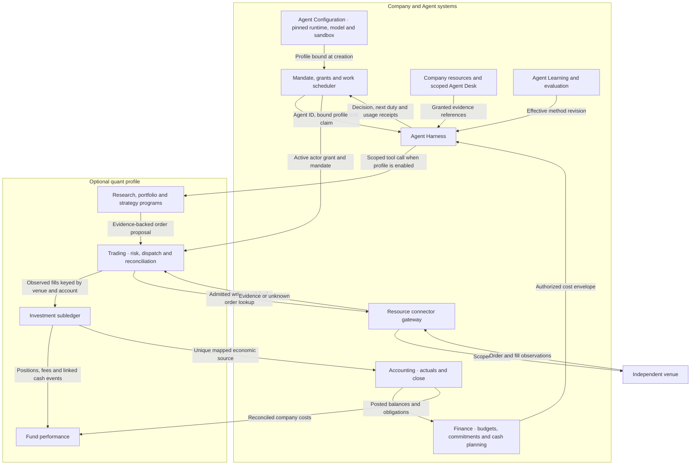

# From Company and Employee to operating components

Design draft · [System tree](README.md#system-hierarchy) · [First Agent paper trade](engineering/flow-delivery/goal-01-04.md) · [Delivery lifecycle](engineering/lifecycle.md)

The semantic structure is [Company](company/README.md) and [Employee](employee/README.md). Company systems implement organizational duties; an Agent realizes the employee, not the company itself. The [situation catalog](capabilities.md) defines what must remain true regardless of which components run. The diagrams below concern implementation and its optional business specialization.

The [company, Agent and quant responsibility hierarchy](company-agent-quant.md) and its eight operating diagrams are the companion business view. The [implementation architecture](engineering/implementation-architecture.md) defines module dependencies, physical boundaries, commit scope and compatibility. Both refer to the owning specs; diagrams are design, not observed execution.

The full system view distinguishes the Agent and company-owned personal workspace, shared company systems, the fund's business systems, company-managed software and externally operated services. These are ownership and responsibility boundaries, not mandatory processes or a fixed organizational chart. Company-owned programs can be Agent-developed or adopted; both share asset, authority and operating contracts. A company-managed NautilusTrader instance is distinct from an externally operated Binance account. The only human interaction path is Client, while the company operates without an open Client.

The company exists before it trades. Its stable records describe Agents, authority, work, conversations, assets, authorized resource bindings, operating expenses and obligations. The quant profile adds market observations, investment decisions, targets, deployments, risk reservations, orders, fills, positions and cost-adjusted returns. Company systems may accept profile evidence through a typed reference; they must not require a market, position, venue account, strategy program or trading credential at startup.

## System and dependency boundaries

The [context diagram](README.md) shows actors and runtime boundaries. The diagram here shows **logical owners and the information they exchange**, not a fleet of microservices. In the local MVP company, one unified `CompanyRuntime` service (backed by a single authoritative SQLite store, a `DutyRegistry`, and a three-entity Work kernel) runs all scheduled duties, collaboration, staffing, accounting and enabled profile modules with the Client closed. The independently supervised managed paper venue remains a separate process boundary under its own sender lease (`paper_sender_lease`) with bounded rotating activation segments and drain margins so the company process and simulated venue do not share failure or write authority.

| Surface | Owns | Dependency rule and failure behavior |
| --- | --- | --- |
| Operating systems | `CompanyRuntime` scheduler (`DutyRegistry`, `work_items`, `work_runs`, `work_responsibilities` and `work_conditions`), two-plane Agent Harness (outer capability broker plus OS-sandboxed inner Desk), durable effects, financial books and recovery duties. | Operate from the original store and current grants with **no client process, connection or UI assets**. Loss of the client cannot cancel a duty, release exposure or prevent reconciliation. |
| Projection API | Authorized, versioned read models served on demand over the local Unix domain socket control plane from read-only store connections (`mode=ro`, `query_only=ON`). Domain owners retain authority over the originals. | A query cannot wake an Agent, dispatch an order, refresh a venue by command or change policy. Every result identifies source revision, as-of time and coverage. |
| Control plane | Versioned local HTTP/1.1 + JSON + NDJSON Unix domain socket API bound only under the active `WriterLease`. Authenticates kernel peer credentials and company-enrolled board bindings, checks scoped roles and expected revisions, and persists command receipts. The domain owner applies or rejects the change. | Offered by the service even with the client absent. A request ID and immutable arguments identify retries. After a lost response, read the original receipt; do not infer success from a screen or issue a new command ID. |
| Board Client | Presents projections and offers a UI for authorized control-plane commands. Owns local selection, formatting, Link State and provisional UI state only. | Imports public query/command contracts, never the service's internals, SQLite store, runtime drivers or venue credentials. Keeps Data State separate from Link State: a disconnected client displays last-observed state as stale while locking mutations fail-closed. No service imports the client. |
| Independent venue | Orders, fills and account observations outside the company store in a separately supervised process boundary (`paper_sender_lease`, bounded rotating segments with drain margins). | Only an admitted connector operation can reach it. The venue cannot write the investment book. A crash between fill and company receipt requires lookup and deduplication, not a client reconnect. |

**Acceptance cuts:** the [first trade](engineering/flow-delivery/goal-01-04.md) ends at a confirmed paper fill and booked position with no Client needed. Later, run the [founder continuity trial](acceptance/first-shift/spec.md#first-integration-run) with the Client closed through the next decision. At Client integration, reopen to inspect the matching projection (zero commands) and separately disconnect after submitting a risk suspension. Enforcement follows the service's effective revision; reconnect resolves the original receipt. No pending UI state counts as an applied suspension.

## Dependency and authority boundaries

| Boundary | State owned here | Handoff and things it cannot do |
| --- | --- | --- |
| Agent → runtime | Organization binds each new Agent ID to one immutable [execution profile](employee/agent/configuration/compose/spec.md); the adapter owns only run/session handles. | Restart that binding under a new generation. Another runtime means another Agent, never the old grants or private desk; an explicitly accepted duty and its original effect references can move. |
| Personal → shared → company resource | A personal desk is a company-owned, Agent-scoped durable working set. A shared project has its own grant and custodian; scratch may disappear. | Sharing an asset reference does not share personal notes, grant access to a secret, transfer an obligation or assign custody. Each requires its own operation. |
| Conversation → work | A thread owns its audience, messages and delivery cursors; the work system owns assignments and acceptance. | A mention can cause a bounded wake. Posted, delivered, read, accepted and completed are distinct observations. A message cannot itself place an order. |
| Core → external system | The connector gateway owns destination binding, scoped operation, evidence and unknown outcome. | A read-only document source needs no order schema. A venue adapter describes domain-specific units, order statuses and finality; a generic timeout is not a rejection. |
| Fund → external system | Fund research and reconciliation own their domain questions and interpretation. | They may invoke permitted connector reads directly; a trading runtime is not a prerequisite for every research input or original-order lookup. Each admitted write still follows the domain safety boundary. |
| Candidate → effective operation | Asset custody retains candidate and history; an independent evaluator records its verdict; operations records effective activation. | Code authorship, publication, functional approval, economic improvement and authorization are different facts. [Company changes](company/systems/operations/manage-change/intent.md) and [product maintenance](company/systems/operations/request-maintenance/intent.md) have separate authority. |
| Resource request → assignment | Authority owns the effective grant; finance owns the budget; resources owns the usable assignment. | [Provisioning](company/systems/resources/provision-resource/intent.md) records the disposition and retires access without discarding company custody or unresolved effects. |
| Quant execution → investment book | Risk admits an immutable order; the venue owns independent fills; the subledger owns positions, reservations and fees. | The Agent, strategy author, generic connector and board view cannot directly write positions. |
| Investment book → corporate accounting | A uniquely identified economic source maps fill cash effects into balanced journal entries. Company accounting also accepts non-trading sources such as compute usage. | Booking a derivative changes quantity in the subledger; the fee is not deducted again on period close. A late journal receipt is not a reason to resubmit an order. |
| Accounting → finance | Accounting owns posted actuals and close. Finance owns budgets, outstanding commitments, liquid cash forecasts and funding shortfalls. | An allocation creates no expense, a forecast moves no cash and a cash balance is not trading exposure headroom. |
| Operations → owning system | Operations owns incidents, due checks and recovery evidence; each domain owns the authoritative repair. | Restart can recover a process, but it cannot invent an absent venue fill, missing accounting receipt or granted permission. |

See the [Agent Harness contract and qualification ladder](employee/agent/harness/protocol.md) for canonical events, context visibility, cancellation, recovery and adapter precedents.

## Two connection ports, not one universal agent plugin

**One trading core, separate source and execution bindings.** The company [prepares, configures, starts and supervises its selected trading runtime](company/profiles/quant/trading/execution-environment/launch/spec.md), using its market-data, backtesting, simulation and execution functions rather than implementing a second engine. The company retains authority, idempotent effect handling and recovery around that runtime. The same risk, order, ledger and recovery contracts operate with historical replay, forward paper and separately authorized external execution. An execution binding chooses the virtual or external venue; a separate read-only market-data binding may select current production observations for paper. Never derive a real-order grant from a market-data connection. Preserve original account/binding and unresolved effects when changing destinations. Use the [environment contract](company/profiles/quant/trading/execution-environment/intent.md), [historical replay](company/profiles/quant/investments/backtest/intent.md) and [current-market paper](company/profiles/quant/trading/live-paper/intent.md). Actual fills, costs and venue semantics can differ; same interface is not proof of identical economics.

**Agent execution port** — Register and disable adapter revisions; describe supported start, stop, tool use, recovery, usage and isolation. Select a compatible runtime/model when configuring a new Agent; a turn may run only that Agent’s pinned binding with current company permissions. Local and remote runtimes can use this port after qualification; a different model string on one backend is not proof of cross-runtime portability. If native resume is absent, a new session on the same binding may reopen that Agent’s permitted desk. Never silently switch paid providers, replay an unknown effect or expose one provider's credentials to another. See [registration and qualification](employee/agent/harness/adapters/intent.md).

**External resource port** — Register the outside resource, destination, operation schema, authentication handle, environment and read/write/recovery capabilities. Bind each call to authorization and an observed receipt. Prove the common path with a read-only non-financial fixture as well as the independently stateful simulated venue; do not force venue-specific fields onto other connectors. A Binance testnet profile is one optional external qualification, not the connector interface itself. See [connector contracts](company/systems/connectors/connect-resource/intent.md).

## Worked economic boundary

A model run with a budget of 10 reserves 6 and incurs 4 currency units. Finance releases the unused 2 after settlement: 6 units remain available from the original 10. Accounting records an expense of 4 against cash if paid or a payable if unpaid, once by usage receipt. Treasury counts that expense as a future cash outflow only while unpaid. None of these actions creates a trade.

Separately, a synthetic two-contract derivative fill at USD 50,000 with a multiplier of 0.001 BTC has USD 100 notional. At four basis points the fee is USD 0.04. Execution resolves the original order, the position book records two signed contracts, corporate accounting records the USD 0.04 fee once, and the fund report uses that same source. Neither the notional nor the budget is corporate revenue. This is an accounting fixture, not an investment result.

## Evidence for the two layers

| Qualification | Exercise | Pass evidence |
| --- | --- | --- |
| Core independence | Found a company with the quant profile disabled and no venue credentials. An Agent reviews a document fetched by a read-only connector, discusses it privately, explicitly hands off work, and a colleague continues with only authorized shared assets. | Compare founder/work IDs, message vs acceptance receipts, desk access, next duty and the authorized work projection. Verify no market or trading service was consulted. This is a boundary regression, not a replacement first integration. |
| Configuration choice and succession | Run two independently created Agents on distinct admitted runtime/model choices. Restart A on its original binding, reject running A on B’s binding, then hand a company duty to B. | Compare distinct IDs and profile references, retained attribution, current grants, desk isolation, a fenced late callback and one application of each original effect. Fixture conformance and actual runs are separate results. |
| Corporate money cycle | Allocate an operating budget, reserve and settle model cost, reconcile the journal, close the period and forecast cash. Replay a charge and withhold a statement. | One expense, balanced journal, no doubled cash outflow; a missing statement prevents a clean close. No bank or trading credential is required for the fixture. |
| First trade | One actual Agent submits an order through the company and fund boundaries. | A confirmed paper fill and its booked position on the same account; a fixed paper quote is sufficient. |
| Later founder resilience proof | One actual founder discovers work, publishes an as-of finding and uses its result to submit a paper order. Run the [five-step crash and next-shift procedure](acceptance/first-shift/spec.md#first-integration-run) against the bound simulator. | Zero board/test-driver operational commands. One original submission, fill and financial application, a new decision and read-only trace. The product Agent Harness is the actor, not the test driver. |
| Full company plus profile | Run the broader [company episodes](README.md#integration-and-completion), including strategy operations and the bridge from investment book to the corporate ledger. | Trace one fill across both books and the cost-inclusive fund result; keep valuation, Agent judgment, runtime qualification and external venue evidence separate. None of these observations authorizes live trading. |
