# Company, Agent and fund responsibilities

Design draft. All product and integration tests: **NOT_RUN**. [Product intent](intent.md) · [Feature ownership](README.md#system-hierarchy) · [Design conventions](conventions.md).

**Purpose:** Earn long-term company-net returns within delegated risk and cost limits, without daily human operation. An Agent-native company is the hypothesis. These boundaries do not prescribe departments or deployment units. The diagrams describe contracts, not observed behavior; linked intents and specs own the requirements.

## System boundaries and connections

Employee roles, fund systems and the number of managed programs are illustrative. Agent-created artifacts belong to their business function and the company. People act through the Client; the company works without it.

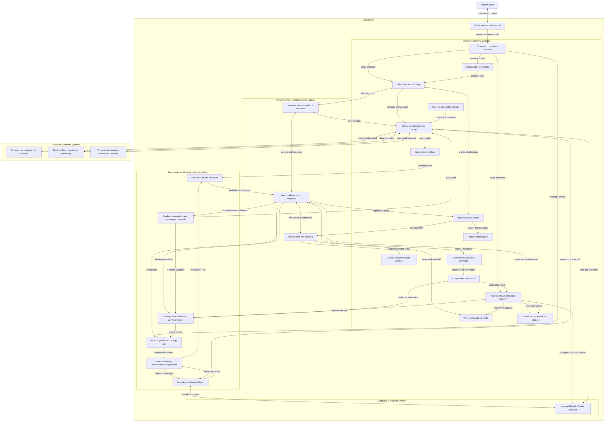

The connector controls external access. Registration does not grant permission to query or act. Risk-increasing orders require a durable order and reservation, domain admission, dispatch-time authority and a current sender. Paper and live accounts are separate bindings; reading a live price never grants live execution.

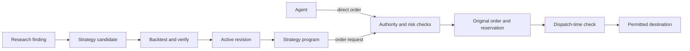

A direct order does not require an activated strategy. A program's execution grant is not its author's grant. Replay and forward paper use the same company controls but distinct environments and source records.

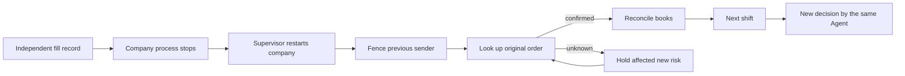

Source durability and the NautilusTrader integration require qualification; neither implies building another trading engine. Founder and hired-Agent resilience are separate later tests. [Founder resilience](acceptance/first-shift/spec.md) · [Hired-Agent continuity](acceptance/hired-agent-continuity/spec.md) · [Execution parity](acceptance/execution-parity/spec.md).

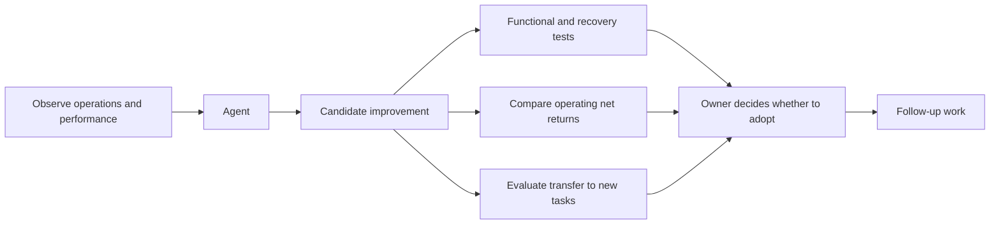

Measure initial paper return after costs before comparing a candidate under matched conditions. Functional success, paper performance and improvement of a learning procedure require different evidence. Missing costs or marks remain unknown. [RSI evaluation](acceptance/recursive-learning/spec.md).

## Responsibility hierarchy

```text
Sourdough
├─ Company — owns purpose, mandate, assets, records and obligations
│  ├─ Common systems
│  │  ├─ Organization: founding, hiring, roles, offboarding
│  │  ├─ Authority: identity, delegation, revocation
│  │  ├─ Work: discovery, shifts, ownership, next action
│  │  ├─ Collaboration: conversations, sharing, handoffs
│  │  ├─ Resources: desks, company code and data, custody and access
│  │  ├─ Connectors: bounded access to markets, venues and other services
│  │  ├─ Finance: budgets, available funds, cost reservations
│  │  ├─ Accounting: actual costs, cash flows, company books
│  │  └─ Operations: observation, incident handling, restart and recovery
│  └─ Quant systems — the business the company conducts
│     ├─ Market observation: prices, accounts and as-of times
│     ├─ Investment research: hypotheses, experiments, strategy evaluation
│     ├─ Portfolio: target positions and capital allocation
│     ├─ Strategy operations: company-owned trading code and revisions
│     ├─ Trading and risk: admit, send, cancel and reconcile original orders
│     └─ Investment books: fills, positions, net assets and returns
└─ Employee
   └─ Agent — the software actor that performs the employee's work
      ├─ Configuration: pinned runtime and model at creation
      ├─ Harness: context, run and tool mediation
      ├─ Desk: scoped personal workspace
      └─ Learning: experience, candidates, evaluation and adoption
```

Company and Employee are organizational subjects. Finance manages company budgets; portfolio management addresses investment exposure. The Agent judges; the system enforces risk. The board sets the mandate and may intervene, but does not approve ordinary shifts. The Client reads projections and submits authorized controls. Common systems work without trading schemas. The investment book is the sole writer for account reservations and positions; the venue owns the fill record.

## Resource allocation and change control

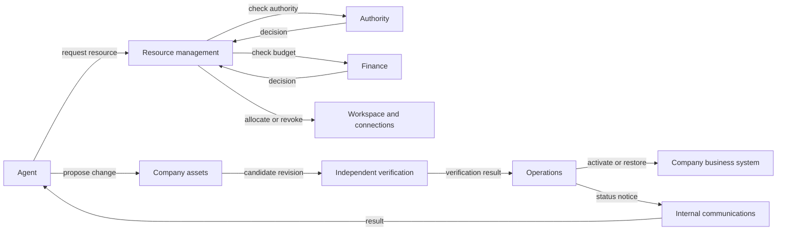

A request, a budget decision, a grant and an allocation are distinct records. Agents can improve business systems and authorized extensions; proposing, independently verifying and activating a change are separate responsibilities. [Resource allocation](company/systems/resources/provision-resource/intent.md) · [Company change](company/systems/operations/manage-change/intent.md).

## Product maintenance and updates

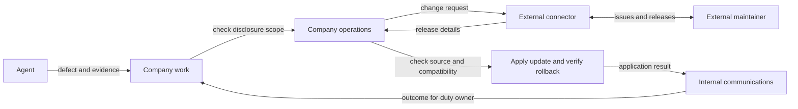

Request foundation changes from the maintainer. Issue closure, release publication, local installation and retesting the original defect are distinct. Operate within the standing mandate without the Client; escalate out-of-scope decisions to a human through it. [Maintenance request](company/systems/operations/request-maintenance/intent.md).

## 1. Hiring

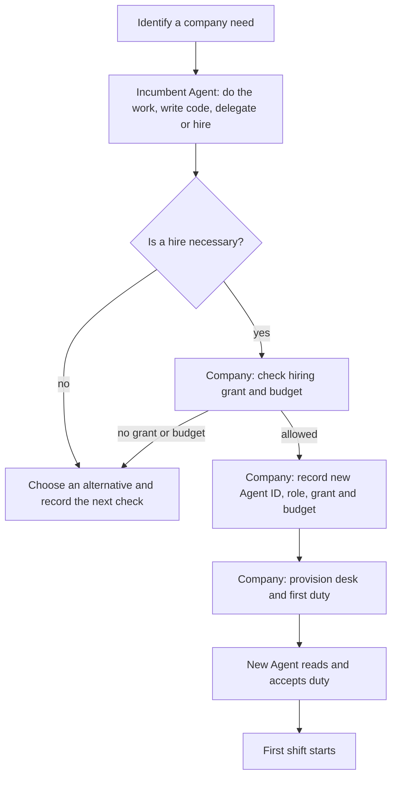

The company records identity and grants. Agents judge staffing needs and decide whether to accept work. A different runtime or model creates a distinct Agent. Roles are not preallocated. [Staffing decision](company/systems/organization/organize-work/intent.md) · [Hiring](company/systems/organization/hire/intent.md) · [Create identity](company/systems/organization/hire/issue-grant/spec.md) · [Accept duty](company/systems/organization/hire/onboard/spec.md) · [H1 hiring](acceptance/episodes.md#h1-hiring) · [Hired-Agent continuity](acceptance/hired-agent-continuity/spec.md).

## 2. Individual work

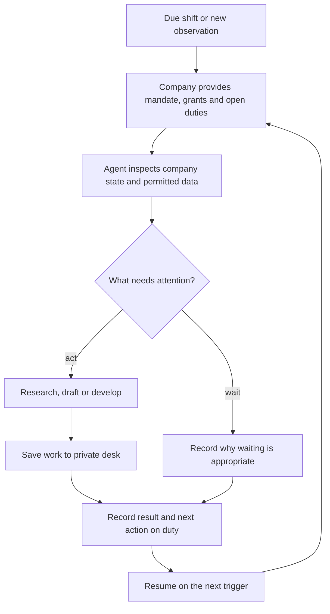

The company retains the duty and next trigger; the Agent chooses an action. Desk privacy restricts access; it does not transfer company ownership. [Discover work](company/systems/work/discover-work/intent.md) · [Decide](company/systems/work/discover-work/decide/spec.md) · [Agent desk](employee/agent/desk/intent.md) · [Reopen desk](employee/agent/desk/reopen/spec.md) · [W1 personal work](acceptance/episodes.md#w1-personal-work).

## 3. Collaboration

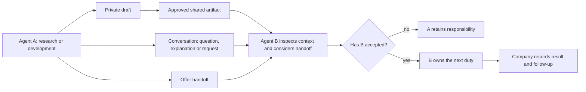

Sharing an artifact, receiving a message and accepting a duty are different events. A keeps responsibility until B accepts; there is then one accountable owner. [Conversations](company/systems/work/conversations/intent.md) · [Publish](employee/agent/desk/publish/spec.md) · [Collaborate](company/systems/work/collaborate/intent.md) · [Handoff](company/systems/work/collaborate/handoff/spec.md) · [W1 personal work](acceptance/episodes.md#w1-personal-work).

## 4. Trading

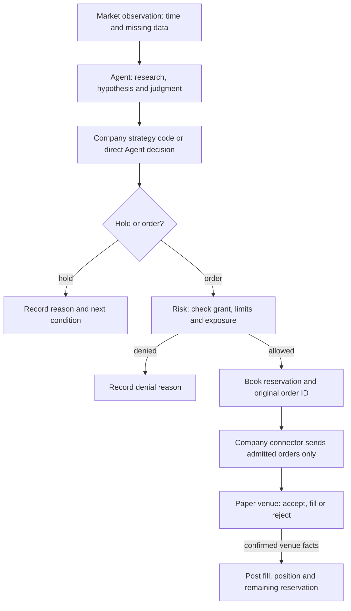

Direct Agent orders and company programs pass the same risk admission. Risk decides eligibility; the investment book creates, changes and releases reservations. A venue fill and its company posting are separate facts. The first delivery ends when the Agent's first paper fill reaches the books. [Market observation](company/profiles/quant/investments/market-snapshot/intent.md) · [Research](company/profiles/quant/investments/research/intent.md) · [Order admission](company/profiles/quant/trading/admit-intent/reserve/spec.md) · [Book fill](company/profiles/quant/fund-books/book-fills/post/spec.md) · [Founder resilience](acceptance/first-shift/spec.md#first-integration-run).

Reconcile venue-originated account changes against their source. If a position or origin is uncertain, hold affected new risk and keep the investigation open. Never attribute an external effect to an Agent without evidence or invent a balancing fill. [Reconcile external effects](company/profiles/quant/trading/recover-order/reconcile-external/spec.md).

### One trading core, distinct execution environments

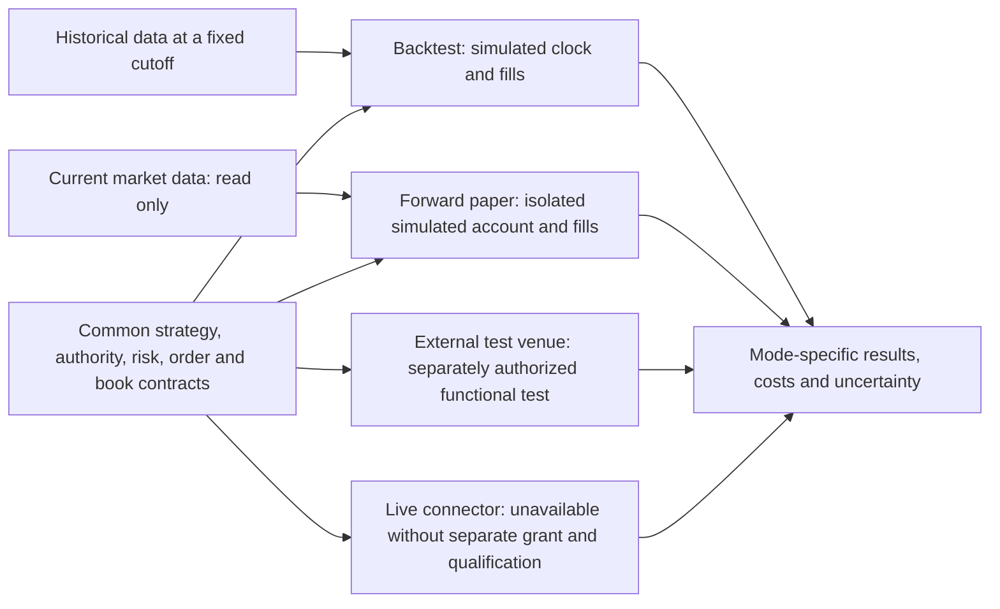

Current data is a read-only source binding; the order destination is a separate execution binding. Recent testnet timestamps do not prove production liquidity or price parity. These environment qualifications are later work, not prerequisites for the first trade. [Backtest](company/profiles/quant/investments/backtest/replay/spec.md) · [Forward paper](company/profiles/quant/trading/live-paper/run/spec.md) · [Execution binding](company/profiles/quant/trading/execution-environment/bind/spec.md) · [Parity test](acceptance/execution-parity/spec.md).

The company provisions, configures and operates the selected runtime and uses its backtest, paper and execution functions. Sourdough owns authority, idempotency, retry and eventual recovery rather than implementing the trading engine. Selection does not mean a runtime is installed or qualified. [Runtime setup](company/profiles/quant/trading/execution-environment/launch/spec.md) · [Engine qualification](company/profiles/quant/trading/execution-environment/qualify-engine/spec.md).

```mermaid
flowchart LR
    Agent["Agent or service configures within grant"]
    Config["Company validates and persists version, mode, market, strategy and account"]
    Supervise["Company provisions, starts, observes and restarts runtime"]
    Runtime["Trading runtime: data, backtest, paper and live modes"]
    Control["Company: authority, risk, order identity and recovery"]
    Gateway["Company connector"]
    External["Market data and paper or external venue"]
    Agent --> Config --> Supervise --> Runtime
    Runtime -->|request and result| Control
    Control -->|permitted operation| Runtime
    Runtime <-->|permitted request| Gateway
    Control <-->|query source record| Gateway
    Gateway <-->|bound destination| External
```

The Client may display configuration and status but need not be open. A running process is not evidence of a trading or recovery result.

## 5. Recovery qualification

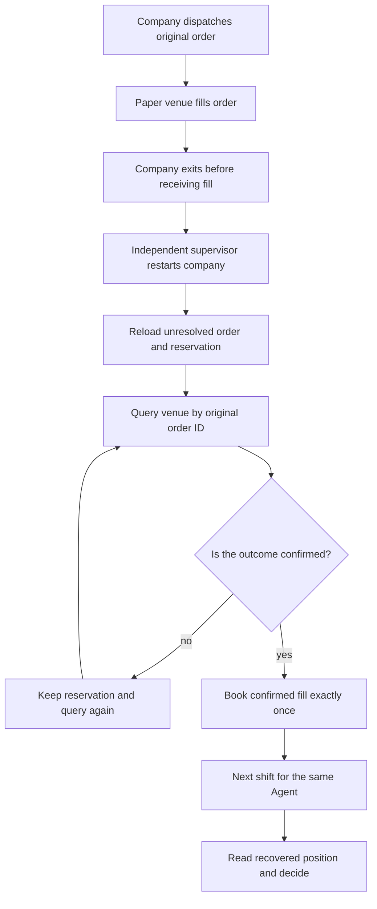

Restart, reconciliation and subsequent work must not require a board or Client command in this later trial. Preserve the reservation while the outcome is unknown. Persist the fill and pending accounting handoff together. A new execution profile requires a distinct Agent and an explicit handoff. [Supervision](company/systems/work/resume-work/supervise/spec.md) · [Order reconciliation](company/profiles/quant/trading/recover-order/reconcile/spec.md) · [Accounting handoff](company/profiles/quant/fund-books/book-fills/journal-source/spec.md) · [Founder resilience](acceptance/first-shift/spec.md) · [Hired-Agent continuity](acceptance/hired-agent-continuity/spec.md).

## 6. Learning and RSI

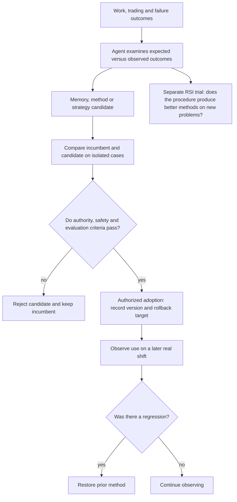

Improving one method is different from improving how methods are produced on new tasks. Agent Learning owns candidates and evaluation; company authority limits adoption. [Learning methods](employee/agent/learning/methods/intent.md) · [Evaluate and adopt](employee/agent/learning/methods/evaluate/spec.md) · [L1 learning](acceptance/episodes.md#l1-learning) · [RSI trial](acceptance/recursive-learning/spec.md).

## 7. Net return

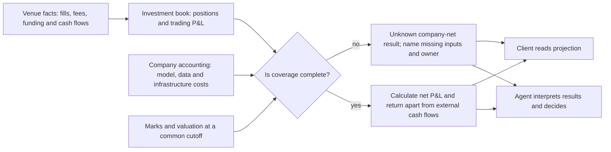

Gross trading profit of 12 less trading costs of 4 gives trading P&L of +8. With company operating costs of 10 the company result is −2. Without cost evidence, company-net return is unknown. The Client displays the company projection; it does not calculate an independent result. [Accounting](company/systems/accounting/accounting-close/intent.md) · [Fund economics](company/profiles/quant/fund-books/fund-economics/intent.md) · [Reconcile inputs](company/profiles/quant/fund-books/fund-economics/reconcile-sources/spec.md) · [Total return](company/profiles/quant/fund-books/fund-economics/total-return/spec.md) · [P1 total return](acceptance/episodes.md#p1-total-return).

## 8. Offboarding and transfer

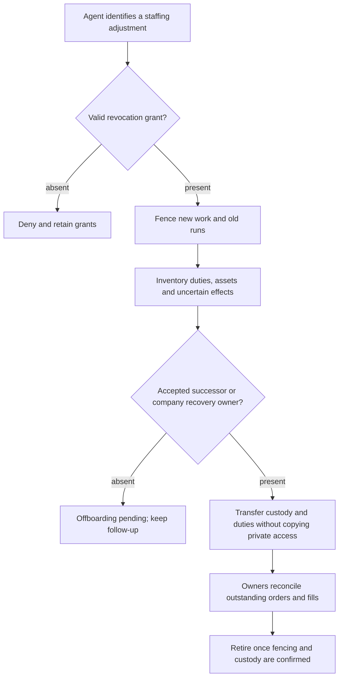

Revocation ends the employee's authority, not the company's obligations. [Offboarding](company/systems/organization/offboard/intent.md) · [Fence access](company/systems/organization/offboard/fence/spec.md) · [Settle custody](company/systems/organization/offboard/settle-custody/spec.md) · [O1 offboarding](acceptance/episodes.md#o1-offboarding).

## Order of delivery and evidence

First demonstrate one Agent order, paper fill and booked position. Later verify continuous trading and qualify the founder and newly hired Agent in separate fault trials. Measure initial company-net return prospectively, then compare the candidate and incumbent in a new matched window. RSI is separate and does not block measuring return. [Integration and acceptance](README.md#integration-and-completion) · [Evidence order](README.md#build-and-evidence-order).
