# 회사 · Agent · 퀀트 책임 계층과 업무 흐름

설계 초안 · 모든 제품·통합시험 **UNRUN** · [제품 목적](intent.md) · [기능별 소유자](README.md#system-hierarchy) · [설계 규칙](conventions.md)

**목적:** 사람이 일상 운용에 개입하지 않아도 정해진 위험·비용 한도 안에서 회사의 장기 순수익을 창출한다. Agent-native 회사가 이를 달성할 수 있다는 것은 가설이다. 이 문서의 계층은 역할과 책임의 구분이지 별도 프로세스나 고정 부서의 요구가 아니다. 다이어그램은 계약을 이해하기 위한 설계 증거이며 실행·합격 증거가 아니다. 기능 요구사항은 링크된 intent와 spec이 소유한다.

## 전체 시스템 경계와 연결

직원 Agent의 역할, 펀드 업무 시스템의 구성, 회사 관리형 소프트웨어의 개수는 예시이며 고정 조직이나 필수 배포 단위가 아니다. Agent가 개발한 결과물은 별도 계층이 아니라 담당 업무와 회사 자산에 속한다. 사람은 Client로만 조회·통제하며 Client가 없어도 회사는 운영된다.

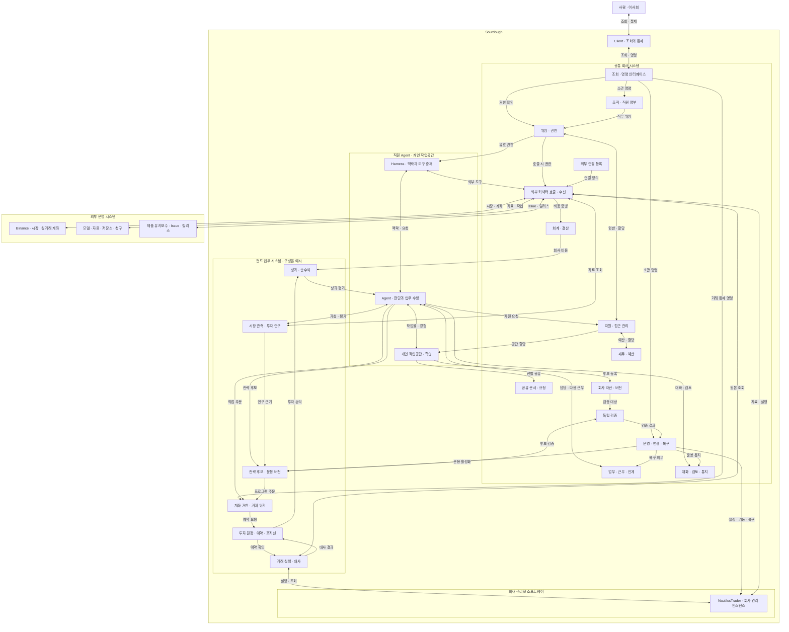

커넥터는 통제된 외부 접근 경계다. 연구·대사는 직접 조회할 수 있지만 등록만으로 호출이 허가되지는 않는다. 위험 증가 주문은 원주문과 예약의 영속 기록, 도메인 승인, 전송 시점 권한과 현재 송신자 확인을 거친다. 모의 계좌와 실거래 계좌는 독립 바인딩이며 현재 실시간 시장 데이터 조회 권한은 실거래 권한이 아니다.

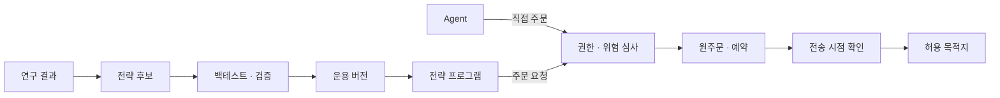

직접 주문에는 전략 프로그램 활성화를 요구하지 않는다. 프로그램의 실행 권한은 작성자의 권한과 구별한다. 과거 재생과 현재 시장 기반 모의 운용은 동일한 회사 통제 계약을 사용하되 각 실행 환경과 원본을 분리한다.

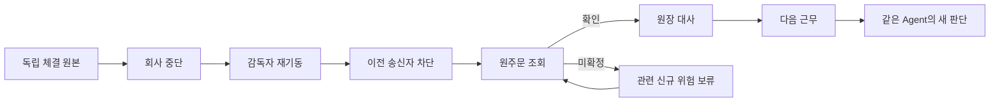

독립 원본의 지속성과 NautilusTrader 연동 방법은 검증 대상이며 별도 거래 엔진 구현 결정이 아니다. 최초 창업 Agent와 신규 채용 Agent의 각 통합시험은 서로 대체하지 않는다. [창업 시험](acceptance/first-shift/spec.md) · [채용 시험](acceptance/hired-agent-continuity/spec.md) · [거래 환경 시험](acceptance/execution-parity/spec.md).

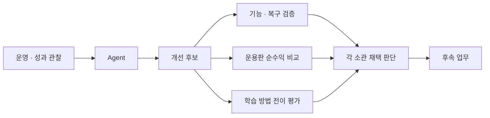

최초 운용판의 비용 차감 후 모의 순수익을 먼저 측정하고 이후 동일 조건으로 후보판을 비교한다. 기능 합격, 모의 수익과 [RSI 평가](acceptance/recursive-learning/spec.md)는 각기 다른 증거다. 누락된 비용이나 평가 자료는 0이 아닌 미확정이다.

## 전체 책임 계층

```text
Sourdough
│
├─ 회사 Company
│  │  목적·위임·자산·기록·의무를 지속적으로 소유
│  │
│  ├─ 공통 회사 시스템
│  │  ├─ 조직       회사 설립, 채용, 역할, 퇴직
│  │  ├─ 권한       신원 확인, 위임, 권한 철회
│  │  ├─ 업무       일 발견, 근무, 책임, 다음 행동
│  │  ├─ 협업       대화, 공유, 업무 인계
│  │  ├─ 자원       개인 작업공간, 회사 코드·자료의 소유와 접근
│  │  ├─ 커넥터     시장·거래소 등 외부 자원 연결
│  │  ├─ 재무       예산, 사용 가능 자금, 비용 예약
│  │  ├─ 회계       실제 비용·현금 흐름·회사 장부
│  │  └─ 운영       상태 관찰, 장애 대응, 재시작과 복구
│  │
│  └─ 퀀트 시스템 — 회사가 영위하는 사업
│     ├─ 시장 관측   가격·계좌 정보와 당시 알 수 있었던 시점
│     ├─ 투자 연구   가설, 실험, 전략 평가
│     ├─ 포트폴리오 목표 포지션, 자본 배분
│     ├─ 전략 운용   회사가 소유한 매매 코드와 버전
│     ├─ 거래·위험   주문 승인, 전송, 취소, 원주문 대사
│     └─ 투자 장부   체결, 포지션, 순자산, 수익률
│
└─ 직원 Employee
   └─ Agent — 직원을 소프트웨어로 구현
      ├─ 구성       어떤 런타임·모델로 생성된 Agent인지
      ├─ Harness    업무 맥락 전달, 실행과 도구 요청 중재
      ├─ Desk       허용된 개인 작업공간
      └─ Learning   경험, 개선 후보, 평가와 적용
```

회사·직원은 의미상 주체다. 재무와 포트폴리오는 각각 회사 비용 예산과 투자 노출을 다룬다. 직원의 투자 판단과 시스템의 위험 집행은 다르다. 이사회는 목적과 위임 한도를 정하고 필요할 때 통제하며, 보통의 근무를 지시하거나 승인하지 않는다. Client는 권한 있는 projection 조회와 control-plane 명령을 제공할 뿐 운영의 의존성이 아니다. 공통 기능은 퀀트 계좌나 주문 스키마 없이 동작한다. 계좌별 투자 원장은 예약·포지션의 단일 작성자이며 거래소는 체결 원본이다.

## 자원 할당과 변경 관리

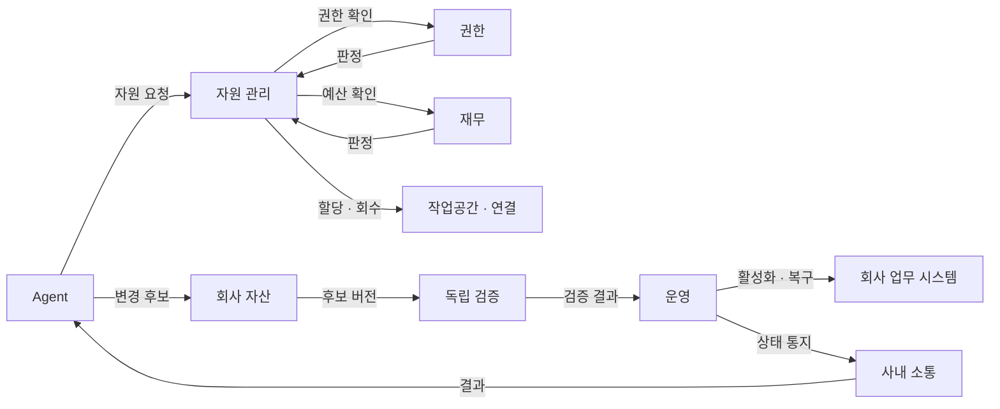

자원 요청·예산·권한·실제 할당은 별도 기록이다. 회사 업무 시스템과 허용된 확장은 Agent가 개선할 수 있으며, 작성과 독립 검증 및 활성화는 분리된다. [자원 할당](company/systems/resources/provision-resource/intent.md) · [회사 변경](company/systems/operations/manage-change/intent.md).

## 제품 유지보수와 회사 업데이트

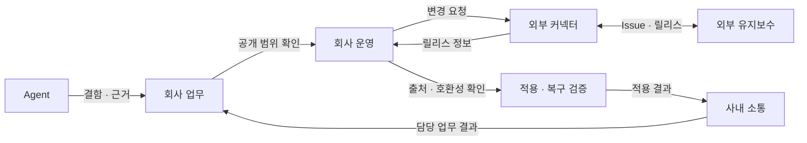

제품 기반의 변경은 유지보수 주체에 요청한다. Issue 종료, 릴리스 게시, 우리 회사의 적용 및 원래 결함 검증은 각각 다른 상태다. 기존 위임 범위의 업데이트는 Client 없이 처리하고, 범위를 벗어난 결정만 사람에게 Client로 요청한다. [유지보수 요청](company/systems/operations/request-maintenance/intent.md).

## 1. 채용

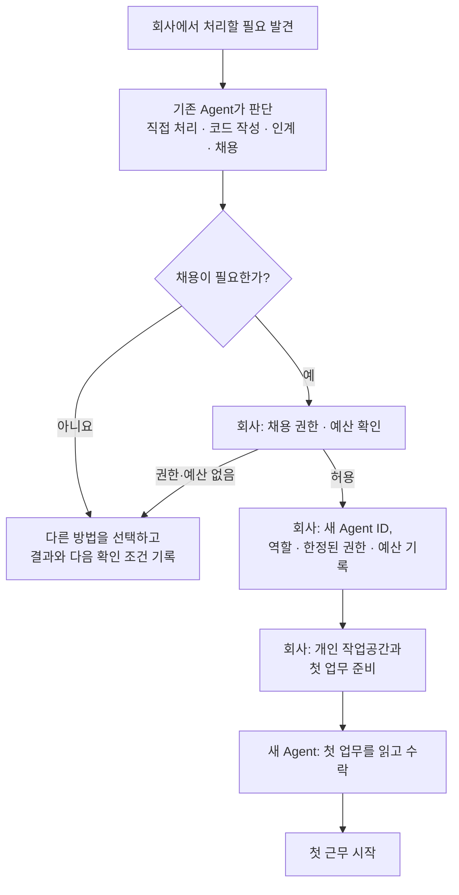

회사는 신원·위임을 기록하고, Agent는 필요와 첫 업무 수락을 판단한다. 다른 모델·런타임은 새 Agent다. 새 역할을 미리 채워 넣을 필요는 없다. [직원 선택 intent](company/systems/organization/organize-work/intent.md) · [채용 intent](company/systems/organization/hire/intent.md) · [생성 spec](company/systems/organization/hire/issue-grant/spec.md) · [수락 spec](company/systems/organization/hire/onboard/spec.md) · [독립 H1 시험](acceptance/episodes.md#h1-hiring) · [채용 후 복구 통합시험](acceptance/hired-agent-continuity/spec.md).

## 2. 개인 업무

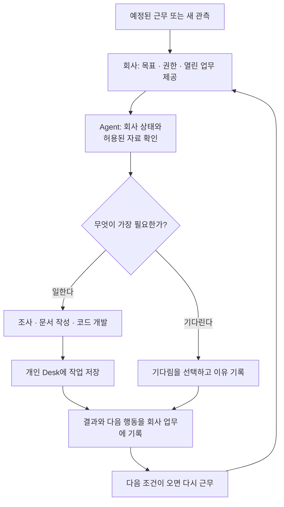

회사는 책임과 다음 조건을 보존하고 Agent가 무엇을 할지 고른다. Desk의 비공개는 접근 제한이지 개인 소유가 아니다. [업무 발견 intent](company/systems/work/discover-work/intent.md) · [결정 spec](company/systems/work/discover-work/decide/spec.md) · [Desk intent](employee/agent/desk/intent.md) · [Desk 복원 spec](employee/agent/desk/reopen/spec.md) · [W1 시험](acceptance/episodes.md#w1-personal-work).

## 3. 협업

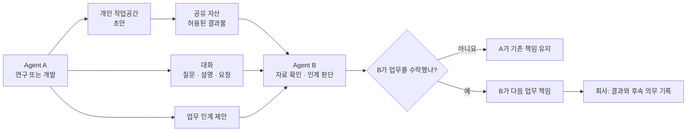

공유·메시지 전달·업무 인수는 각각 다른 사실이다. 회사는 수락 전 A의 책임을 유지하고 수락 시 한 명의 책임자로 전환한다. [대화 intent](company/systems/work/conversations/intent.md) · [공유 spec](employee/agent/desk/publish/spec.md) · [인계 intent](company/systems/work/collaborate/intent.md) · [인계 spec](company/systems/work/collaborate/handoff/spec.md) · [W1 시험](acceptance/episodes.md#w1-personal-work).

## 4. 거래

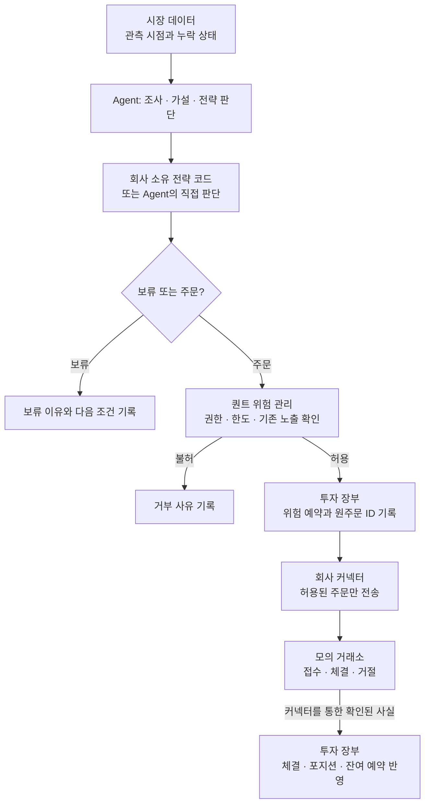

Agent와 Agent가 만든 회사 프로그램은 같은 승인 경계를 거친다. 위험 서비스는 허용 여부를 판단하고 투자 보조원장이 예약을 생성·변경·해제한다. 거래소 체결과 회사 장부는 별도 사실이다. [시장 관측 intent](company/profiles/quant/investments/market-snapshot/intent.md) · [연구 intent](company/profiles/quant/investments/research/intent.md) · [주문 승인 spec](company/profiles/quant/trading/admit-intent/reserve/spec.md) · [체결 spec](company/profiles/quant/fund-books/book-fills/post/spec.md) · [첫 통합시험](acceptance/first-shift/spec.md#first-integration-run).

거래소에서 회사 주문과 독립적으로 발생한 계좌 변동도 원본을 대조한다. 출처나 포지션이 미확인인 동안 관련 신규 위험을 막고 후속 조사를 유지하며, Agent가 지시했다고 꾸미거나 장부를 맞추기 위한 가상 체결을 만들지 않는다. [외부 발생 효과 대사 spec](company/profiles/quant/trading/recover-order/reconcile-external/spec.md).

### 같은 거래 코어와 세 가지 검증 환경

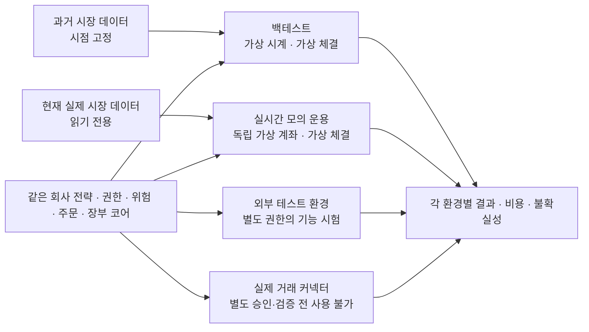

현재 시장 데이터는 읽기 전용 source binding이고 주문 목적지는 별도 execution binding이다. 테스트 환경이 최신 시각을 표시해도 실제 시장 호가·유동성과 같다는 뜻은 아니다. [백테스트 spec](company/profiles/quant/investments/backtest/replay/spec.md) · [실시간 모의 spec](company/profiles/quant/trading/live-paper/run/spec.md) · [공통 코어 spec](company/profiles/quant/trading/execution-environment/bind/spec.md) · [공통 코어 시험](acceptance/execution-parity/spec.md).

회사가 선택한 거래 런타임을 직접 준비·설정·실행·감독하고, 런타임의 거래·백테스트·모의 기능을 사용한다. 회사는 권한·멱등성·재시도·복구를 책임지며 거래 엔진을 새로 구현하지 않는다. [실행·설정 spec](company/profiles/quant/trading/execution-environment/launch/spec.md) · [통합 검증 spec](company/profiles/quant/trading/execution-environment/qualify-engine/spec.md). 런타임 선택은 설계 결정이며, 아직 설치·검증·운용됐다는 뜻은 아니다.

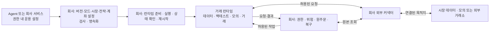

화면은 설정·상태를 표시할 수 있지만 위 경로는 Client가 닫혀 있어도 동작한다. 런타임 실행 상태와 기능별 거래·복구 합격 증거는 별도로 기록한다.

## 5. 복구

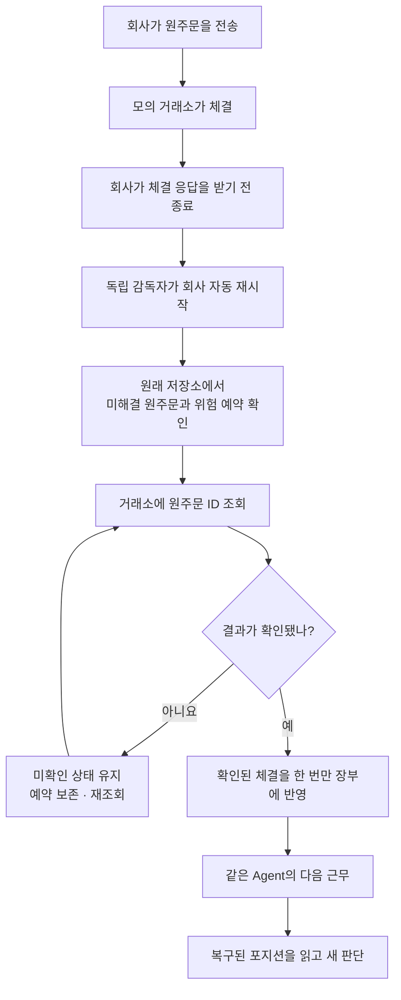

정상적인 재시작·대사·다음 근무는 이사회나 Client를 기다리지 않는다. 조회가 불명확하면 원주문 예약을 유지한다. 체결과 회계 전달 대기 기록은 함께 보존한다. 다른 실행 구성의 Agent는 같은 Agent로 취급하지 않고 별도 인계한다. [감독 spec](company/systems/work/resume-work/supervise/spec.md) · [원주문 대사 spec](company/profiles/quant/trading/recover-order/reconcile/spec.md) · [회계 전달 spec](company/profiles/quant/fund-books/book-fills/journal-source/spec.md) · [창업 시험](acceptance/first-shift/spec.md) · [채용 시험](acceptance/hired-agent-continuity/spec.md).

## 6. 학습과 RSI

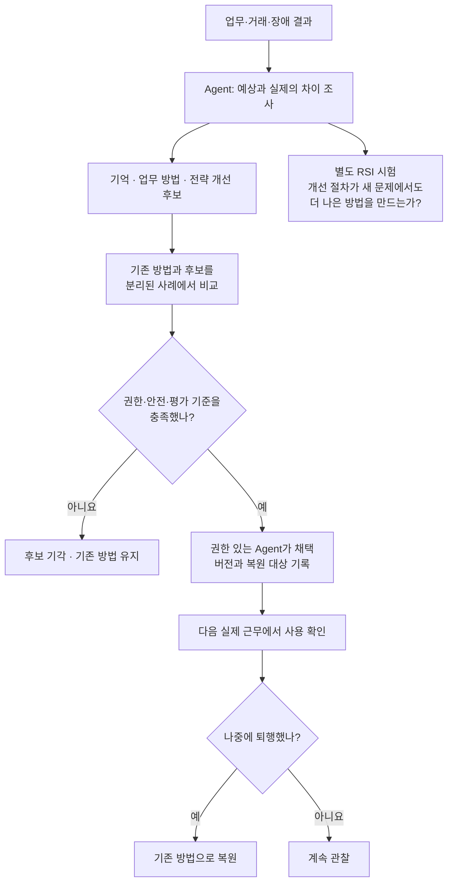

업무 방법을 한 번 고친 것과 개선 절차가 새로운 문제에 일반화되는 것은 다른 주장이다. Agent Learning은 후보와 평가를 소유하고 회사 권한은 적용 범위를 집행한다. [학습 intent](employee/agent/learning/methods/intent.md) · [비교·적용 spec](employee/agent/learning/methods/evaluate/spec.md) · [L1 시험](acceptance/episodes.md#l1-learning) · [독립 RSI 시험](acceptance/recursive-learning/spec.md).

## 7. 순수익 확인

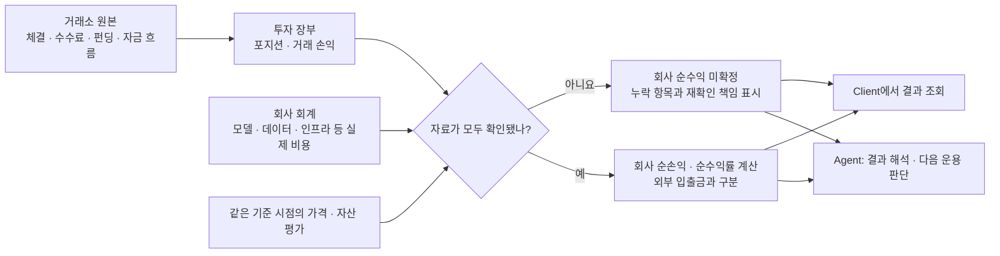

거래 이익 12, 거래비용 4, 회사 운영비 10이면 거래 순손익은 +8, 회사 순손익은 −2다. 비용 증빙이 없으면 회사 순수익은 미확정이다. Client는 계산하지 않고 회사 projection을 표시한다. [회사 회계 intent](company/systems/accounting/accounting-close/intent.md) · [경제성과 intent](company/profiles/quant/fund-books/fund-economics/intent.md) · [원천 대사 spec](company/profiles/quant/fund-books/fund-economics/reconcile-sources/spec.md) · [수익률 spec](company/profiles/quant/fund-books/fund-economics/total-return/spec.md) · [P1 시험](acceptance/episodes.md#p1-total-return).

## 8. 해고와 의무 인계

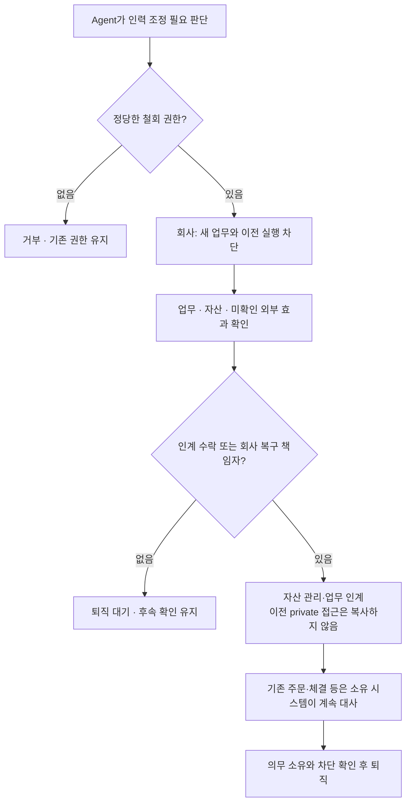

직원의 권한은 끝날 수 있지만 회사 의무는 사라지지 않는다. [해고 intent](company/systems/organization/offboard/intent.md) · [차단 spec](company/systems/organization/offboard/fence/spec.md) · [자산·의무 정리 spec](company/systems/organization/offboard/settle-custody/spec.md) · [O1 시험](acceptance/episodes.md#o1-offboarding).

## 순서와 증거 경계

먼저 창업 Agent의 무인 복구를 한 번의 연속 관측으로 검증하고, 새로 채용된 Agent의 별도 통합시험을 유지한다. 이후 첫 운용판의 회사 순수익을 전향적으로 측정하고, 후보판이 생기면 새로운 같은 기간에 기존판과 비교한다. RSI는 별도로 평가하며 수익 관측을 막지 않는다. 실행 순서와 독립 증거는 [통합·인수](README.md#integration-and-completion)와 [구현·증거 순서](README.md#build-and-evidence-order)를 따른다.
