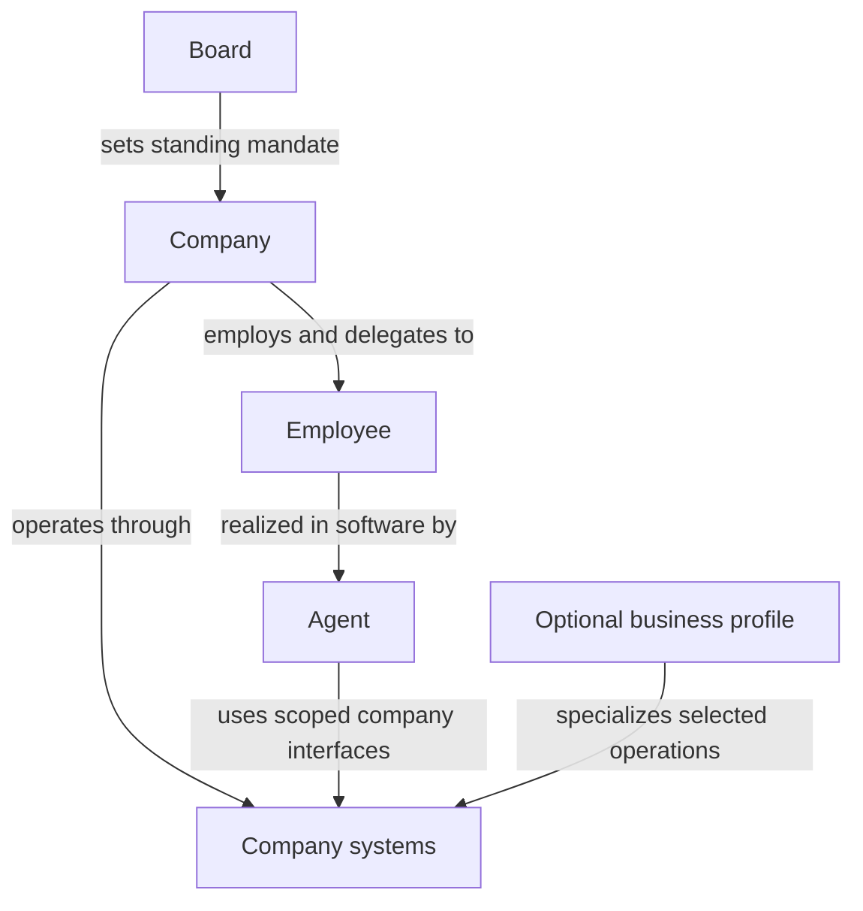
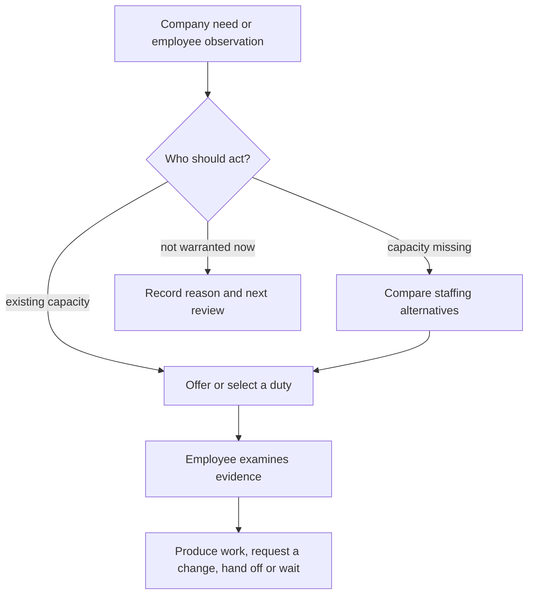
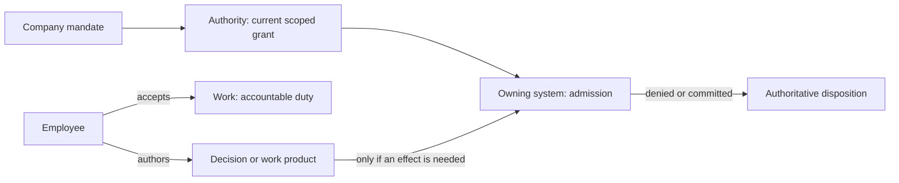
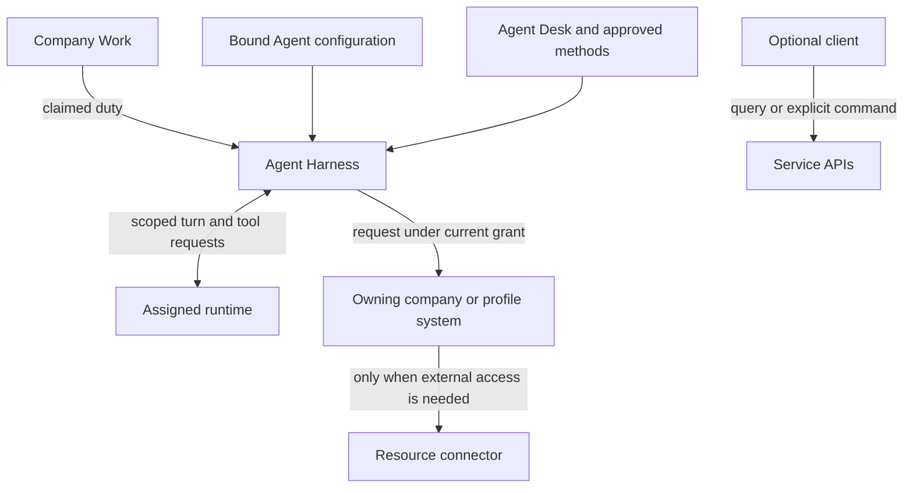
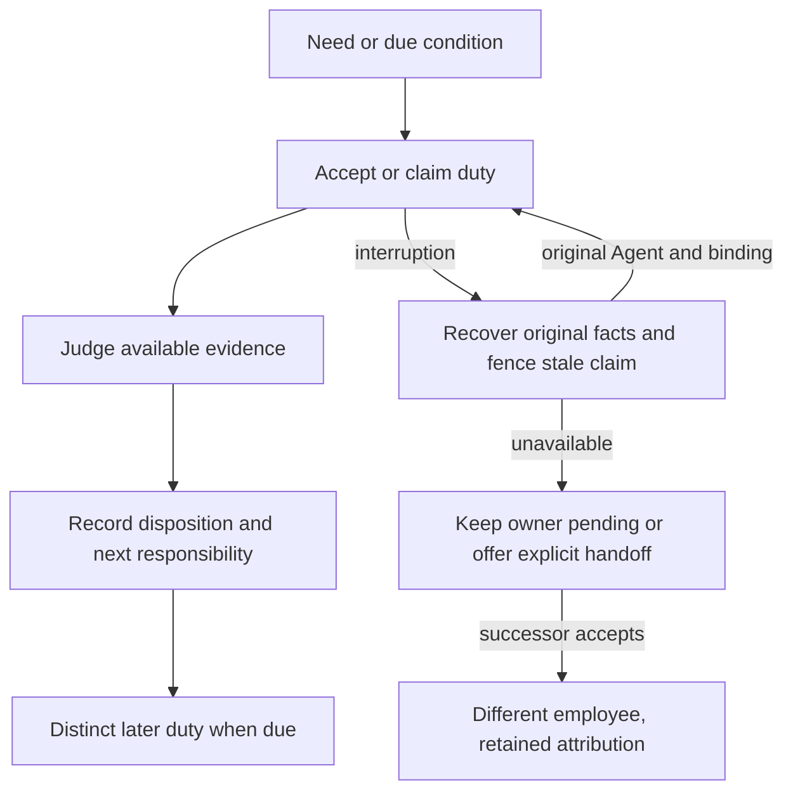
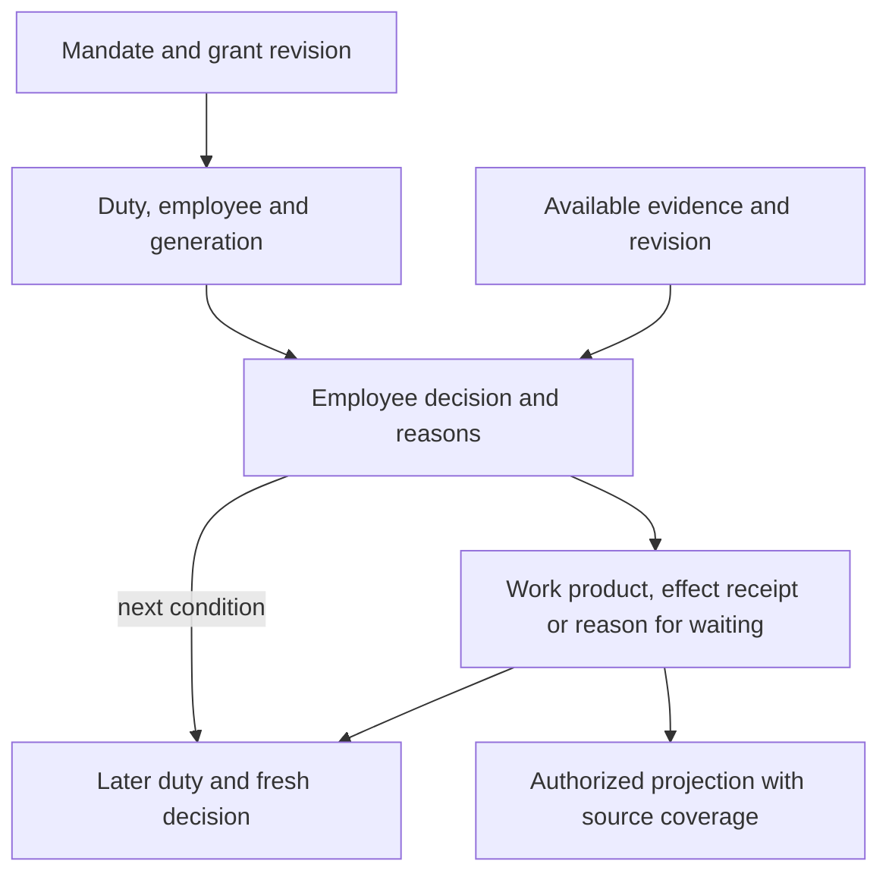
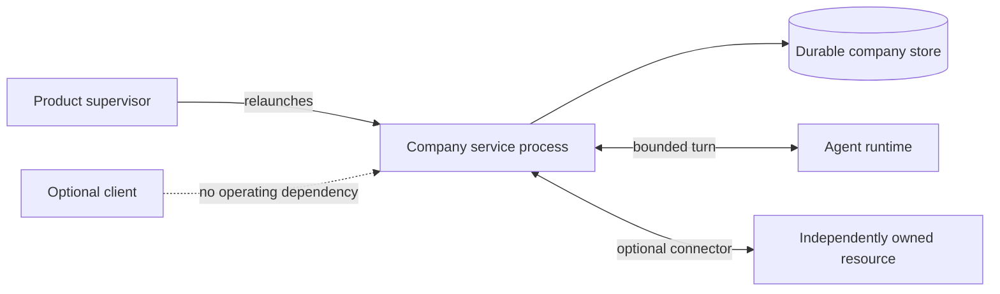
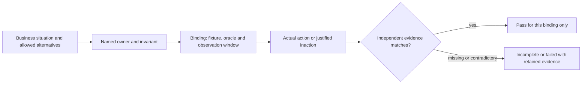

# Company and Employee: eight architecture views

[Business hierarchy](README.md#system-hierarchy) · [Situation catalog](capabilities.md) · [Worked paper-fund example](acceptance/hired-agent-continuity/paper-walkthrough.md)

Read each situation at three levels: **Company and Employee** describe who is responsible and what must remain true; **company systems and Agent** implement those responsibilities; **business profiles and fixtures** supply specialized rules and observations. The eight views below are lenses on the same model, not eight additional layers.

## Company model

**1 · Meaning.** The company owns the mandate, assets and outstanding obligations. An employee exercises judgment and answers for accepted duties. Neither is defined by the software that runs it.

## Business capabilities

**2 · Situations.** An unmet obligation creates a choice, not an automatic hire or operation. Other situations, such as learning, retirement or reporting, can start independently; the [catalog](capabilities.md) maps every feature.

## Decision and write authority

**3 · Authority.** Business authorship is not write authority over a resource. The employee can recommend a change; a named system must decide whether to admit it.

## Logical components and interfaces

**4 · Software.** Company systems expose work, resource and authority contracts. The employee is implemented by an Agent, not by a session, tool, or provider. The optional client consumes service contracts, not vice versa.

## Session recovery versus succession

**5 · Behavior.** The same duty can be resumed; a later duty is not a retry. When the worker changes, responsibility transfers only on an authorized handoff.

## Records and lineage

**6 · Information.** Stable references explain a result without copying an employee's private desk. There need not be a remote action. The owner of a specialized record interprets its contents; Work holds the reference.

## Local fault boundaries

**7 · Deployment.** The employee is not a process. Losing a turn, losing the service, losing the store and retiring an employee have different recovery owners. External systems have independent truth only where the duty actually uses one.

## Quality scenarios

**8 · Evidence.** Select a situation first, then choose its oracle and failure cut. A staffing test needs proof of first-duty acceptance; an advisory duty can succeed with zero external writes. Outcome evidence must come from the record owner, not the Agent's narrative or the UI.

## Follow one decision across views

For example, when an employee leaves, the organizational change is the end of delegated responsibility. Authority owns the cutoff, Work owns any transfer, and Resources owns custody. The Agent's last process exit establishes none of them. Verify the effective cutoff, who accepted pending duties, and which assets remain accessible, using the [offboarding episode](acceptance/episodes.md#o1-offboarding).

For a different question, compare the [generic newly hired employee continuity contract](acceptance/hired-agent-continuity/spec.md) with its [eight-view paper binding](acceptance/hired-agent-continuity/paper-walkthrough.md) and the separate [founder integration](acceptance/first-shift/spec.md#first-integration-run). A local assessment and an independently committed external action have different crash witnesses; the employee's obligation to use the verified result on a later duty is the same.

These are design views, not observed product behavior.
